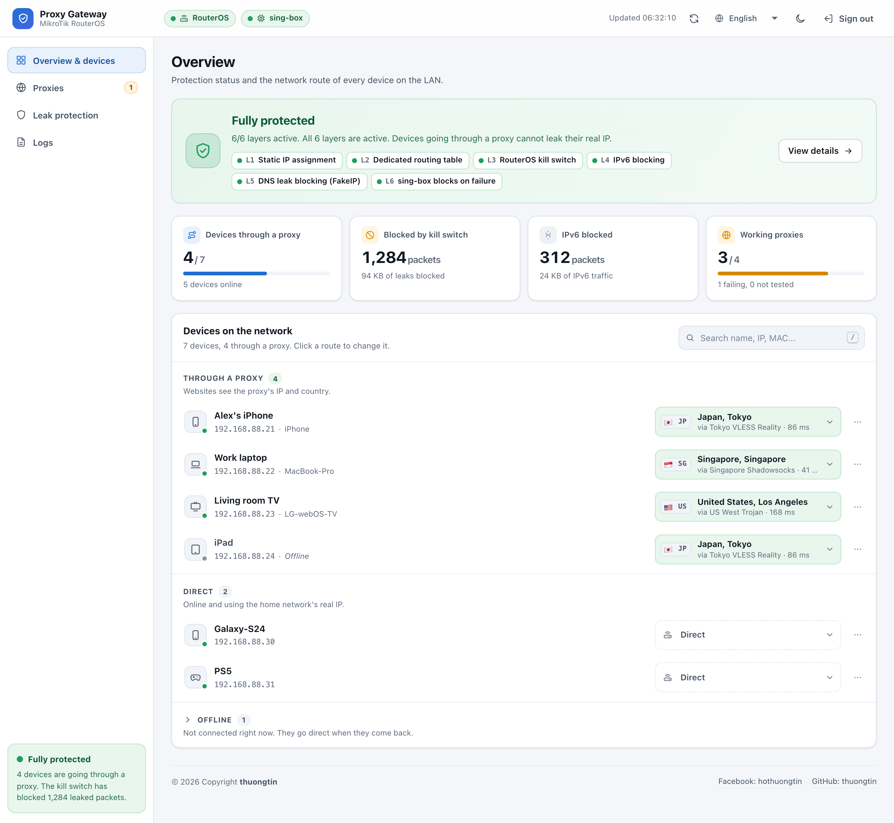
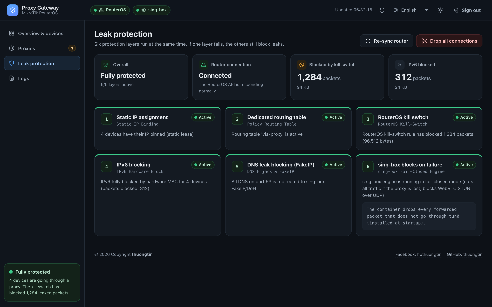
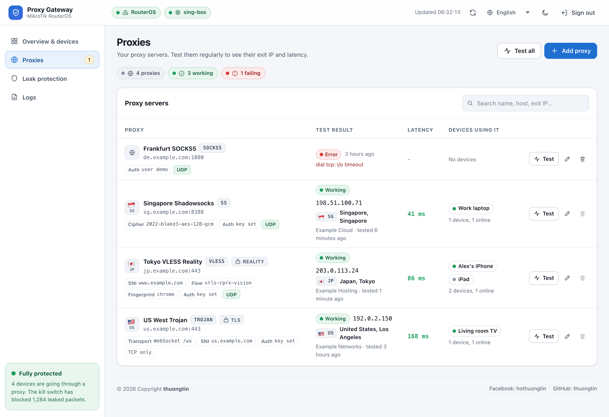
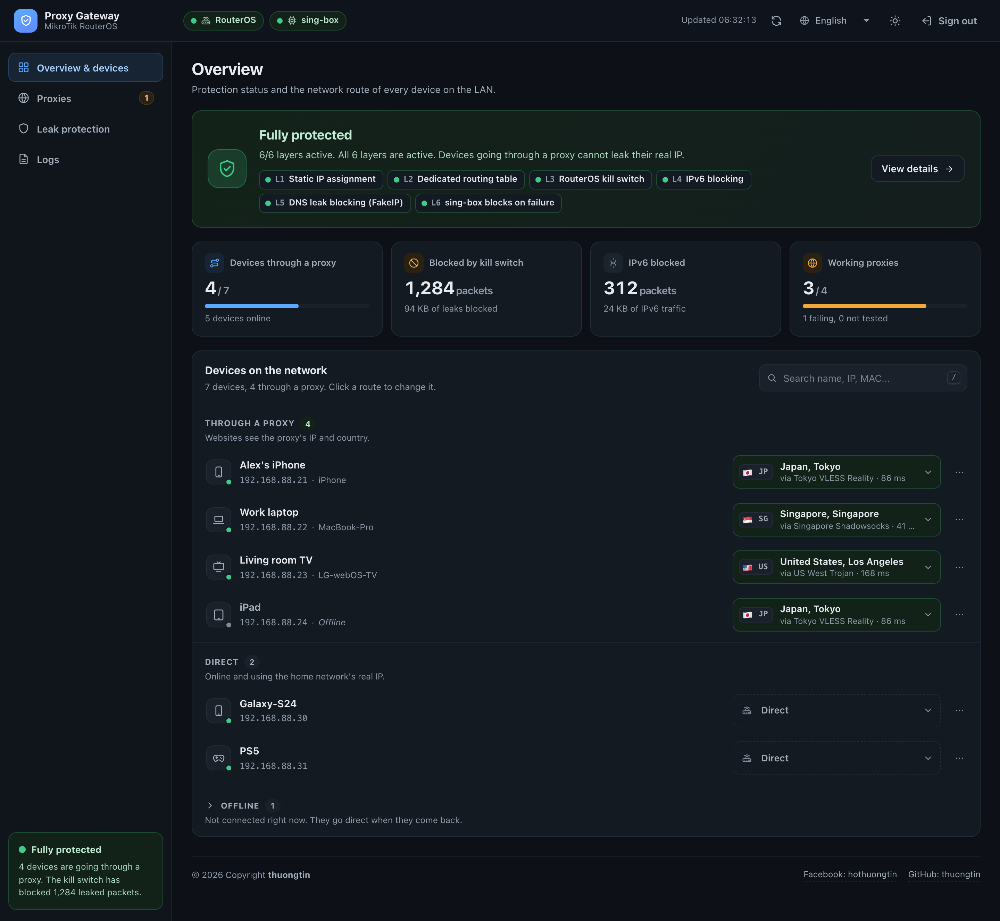
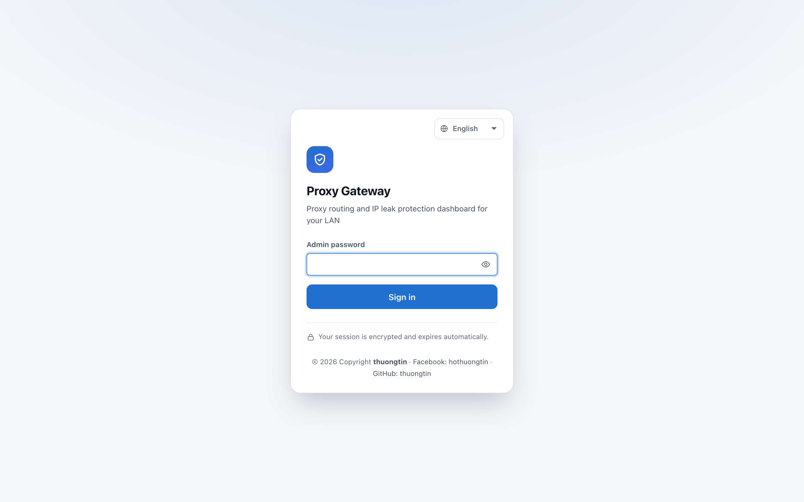
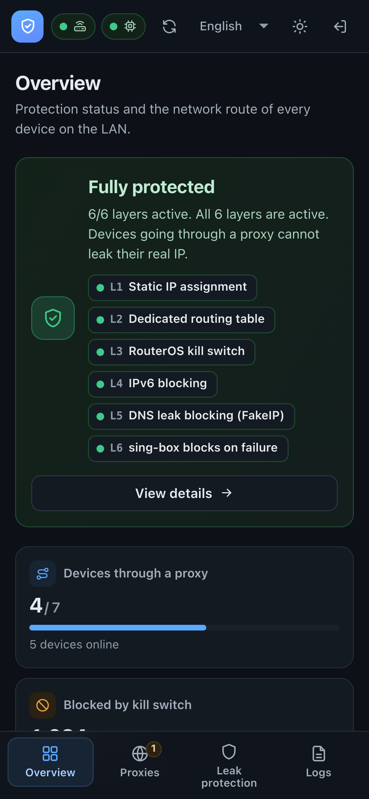

<div align="center">


# MikroTik Proxy Dashboard

MikroTik RouterOS 7용 기기별 프록시 라우팅 및 IP 유출 방지 도구입니다.
라우터 자체에서 컨테이너로 실행됩니다.

[English](README.md) | [Tiếng Việt](README.vi.md) | [简体中文](README.zh-CN.md) | [Русский](README.ru.md) | **한국어**

[](https://github.com/thuongtin/mikrotik-proxy-dashboard/actions/workflows/ci.yml)
[](LICENSE)

</div>

대시보드는 라우터에서 직접 `linux/arm64` 컨테이너로 실행됩니다(RouterOS 7.25가 설치된 RB5009UG+S+에서 사용 중). `sing-box`를 투명 게이트웨이(transparent gateway)로 제어하고, REST API를 통해 RouterOS에 규칙을 추가하거나 제거합니다.

목표: 기기에 프록시가 할당되면 그 기기는 해당 프록시를 통해서만 인터넷에 연결할 수 있습니다. 프록시나 컨테이너에 장애가 생기면 기기는 실제 IP를 노출하는 대신 인터넷 연결을 잃습니다.

> **프로젝트 상태:** LAN을 신뢰할 수 있는 가정 및 소규모 사무실 네트워크에 적합합니다. 2026-11-25 검토에서 1단계 약점을 코드에서 수정했습니다. 일부 항목은 아직 해결되지 않았습니다(대시보드가 일반 HTTP로 제공됨, 스스로 IP나 MAC을 바꾸는 기기, 아직 주기적 모니터링 없음). 배포하기 전에 [docs/security.md](docs/security.md)를 읽어 보세요.

## 스크린샷

<p align="center">
  
  <br><sub>개요: 보호 상태와 각 기기의 경로</sub>
</p>

<table>
  <tr>
    <td width="50%"><br><sub>유출 방지: 6개 보호 계층</sub></td>
    <td width="50%"><br><sub>프록시: 테스트 결과, 출구 IP, 지연 시간</sub></td>
  </tr>
  <tr>
    <td width="50%"><br><sub>다크 모드의 개요</sub></td>
    <td width="50%"><br><sub>로그인 페이지</sub></td>
  </tr>
</table>

<p align="center">
  
  <br><sub>모바일 레이아웃</sub>
</p>

모든 스크린샷은 데모 데이터(문서용 IP 대역, `example.com` 호스트)를 사용합니다.

## 문서

| 문서 | 읽어야 할 때 |
| :--- | :--- |
| [docs/routeros-setup.md](docs/routeros-setup.md) | 라우터에 처음 설치할 때, 설치 후 점검, 제거 |
| [docs/architecture.md](docs/architecture.md) | 데이터 흐름, 코드 구조, API를 이해하고 싶을 때 |
| [docs/security.md](docs/security.md) | 위협 모델, 알려진 약점, 보안 강화 단계를 검토할 때 |
| [docs/roadmap.md](docs/roadmap.md) | 단계별 계획된 기능을 볼 때 |

자세한 문서는 현재 영어와 베트남어([docs/vi/](docs/vi/))로만 제공됩니다.

## 작동 방식

```text
LAN 기기 10.88.88.x  (address-list PROXY_DEVICES에 포함)
        |
        v
RouterOS
  - policy routing: mangle이 PROXY_DEVICES를 표시, 테이블 via-proxy, 게이트웨이 10.10.10.16
  - DNS hijack: 포트 53으로 가는 모든 쿼리를 컨테이너로 리디렉션
  - kill-switch: 이 기기들의 패킷이 WAN으로 직접 나가려 하면 drop
  - MAC 주소별 IPv6 차단
        |
        v
컨테이너 10.10.10.16 (veth-proxy)
  - proxy-dash :8080   대시보드, REST API, RouterOS 제어
  - sing-box           tun0 + DNS :53 (FakeIP, 프록시를 거치는 DoH), 출발지 IP 기준 라우팅
  - forward guard      iptables: 포워딩되는 패킷은 tun0으로만 나갈 수 있음
        |
        v
기기에 할당된 프록시
```

프록시가 없는 기기는 평소처럼 네트워크를 직접 사용하며 이 규칙들의 영향을 받지 않습니다.

## 기능

- **7가지 프록시 프로토콜:** HTTP, HTTPS, SOCKS5, Shadowsocks (SIP002 및 레거시), Trojan, VLESS (Reality, Vision), VMess (WebSocket, gRPC).
- **일괄 가져오기:** `socks5://`, `http://`, `https://`, `vless://`, `vmess://`, `ss://`, `trojan://` 링크나 `host:port:user:pass` 형식을 한 줄에 하나씩 붙여 넣습니다.
- **프록시 테스트:** 임시 `sing-box` 프로세스를 띄워 지연 시간을 측정하고 출구 IP, 국가, ISP를 확인합니다.
- **기기별 할당:** 기기 목록은 라우터의 DHCP 임대(lease)와 ARP 테이블에서 가져옵니다. 기기에 별칭을 붙일 수 있고, 열린 연결을 끊어 새 경로를 바로 사용하게 할 수 있습니다.
- **내장 대시보드:** English, Tiếng Việt, 简体中文, Русский, 한국어 지원, 밝은 테마와 어두운 테마, 인터넷에서 불러오는 리소스 없음.
- **로그인:** `bcrypt` 비밀번호 해시, HMAC-SHA256으로 서명된 세션 쿠키, 로그인 실패가 반복되면 클라이언트별로 일시 잠금.
- **단계별 오류 표시:** 할당이나 할당 해제가 중간에 실패하면 UI가 어느 단계에서 실패했는지, 변경 사항이 적용되었는지 아니면 롤백되었는지 알려 줍니다.

### IP 유출을 막는 6개 계층

| 계층 | 역할 | 설정 주체 | 대시보드 점검 항목 |
| :--- | :--- | :--- | :--- |
| L1 Static IP Binding | DHCP 임대를 고정하여 기기 IP가 바뀌지 않게 함 | 대시보드, 할당 시 | 할당된 모든 기기에 올바른 IP와 MAC의 고정 임대(static lease)가 있음 |
| L2 Policy Routing | `PROXY_DEVICES` 트래픽을 `via-proxy` 테이블로 보냄 | 수동, 1회 | 테이블이 있고, 활성화된 라우팅 규칙이 이를 사용하며, 트래픽을 테이블로 보내는 설정이 있고, 할당된 기기가 `PROXY_DEVICES`에 있음 |
| L3 Kill-Switch | WAN으로 직접 나가는 `PROXY_DEVICES` 패킷을 drop | 수동, 1회 | 규칙이 올바른 chain, action, address list로 활성화되어 있음. out interface가 없거나 accept 규칙이 앞에 있으면 경고 |
| L4 IPv6 Block | forward 및 input chain에서 MAC 주소 기준으로 IPv6를 reject | 대시보드, 할당 시 | 할당된 모든 MAC에 올바른 MAC으로 된 규칙 두 개가 모두 있고 accept 규칙 뒤에 있지 않음 |
| L5 DNS Hijack 및 FakeIP | 포트 53을 `sing-box`로 리디렉션, FakeIP로 응답하고 프록시를 거치는 DoH로 이름 해석, `AAAA`, `HTTPS`, `SVCB` 차단 | NAT는 수동, 나머지는 자동 생성 | UDP와 TCP 모두에 대해 포트 53용 `dst-nat` 규칙이 있고 다른 NAT 규칙에 가려지지 않음 |
| L6 sing-box Fail-Closed | 일치하는 규칙이 없으면 reject하며 절대 직접 연결하지 않음. 프록시가 UDP를 전달할 수 없으면 UDP를 reject(WebRTC STUN 유출 방지). forward guard가 `tun0`을 거치지 않는 패킷을 drop | 자동 생성 | `sing-box`가 실행 중이고 forward guard가 설치되어 있음 |

각 계층은 네 가지 상태 중 하나입니다: 활성, 경고, 오류, 그리고 대시보드가 라우터를 읽을 수 없을 때의 "확인 불가"(화면에는 "알 수 없음"으로 표시). 확인할 수 없는 계층은 절대 활성으로 계산되지 않습니다. 각 조건의 자세한 내용: [docs/security.md](docs/security.md).

## 빠른 시작

1. 이미지를 빌드합니다.

   ```bash
   ./scripts/build-arm64-tar.sh
   ```

   스크립트는 빌드 전에 Docker에서 `go vet`, `go test`, `govulncheck`를 실행하며, 하나라도 실패하면 중단합니다. 결과물: `dist/proxy-gw-arm64.tar`.

2. 대시보드 비밀번호 해시를 만듭니다(요청이 나오면 비밀번호를 입력하세요).

   ```bash
   go run . --hash-password
   ```

3. [docs/routeros-setup.md](docs/routeros-setup.md)를 따라 라우터를 구성하고 컨테이너를 불러옵니다.

4. `http://10.10.10.16:8080`을 열고 상태 페이지를 확인합니다. 첫 기기를 할당하기 전에 6개 계층이 모두 "활성"이어야 합니다. 그런 다음 프록시를 추가하고 테스트한 후 기기에 할당합니다.

5. 할당된 기기에서 직접 `ipleak.net`, `browserleaks.com/dns`, `browserleaks.com/webrtc`, `test-ipv6.com`으로 유출 여부를 확인합니다. 대시보드의 "완전히 보호됨" 상태가 이 단계를 대신하지는 않습니다.

## 구성

모든 설정은 컨테이너의 환경 변수에서 읽습니다.

| 변수 | 기본값 | 의미 |
| :--- | :--- | :--- |
| `DASHBOARD_PASSWORD_HASH` | 비어 있음 | 대시보드 비밀번호의 bcrypt 해시. 필수. RouterOS 터미널에서는 모든 `$`를 `\$`로 써야 합니다 ([이유](docs/routeros-setup.md#4-container)) |
| `MIKROTIK_URL` | `https://10.88.88.1` | RouterOS REST API 주소. 호스트가 라우터 인증서의 SAN에 있어야 함 |
| `MIKROTIK_USER` | `admin` | RouterOS 계정. 전용 계정을 만드세요. 설치 가이드 참고 |
| `MIKROTIK_PASS` | 비어 있음 | 해당 계정의 비밀번호 |
| `MIKROTIK_CA_FILE` | 비어 있음 | 라우터 검증에 쓰는 CA 또는 자체 서명 인증서 자체의 PEM 파일. 비어 있으면 시스템 CA 저장소 사용 |
| `MIKROTIK_INSECURE_TLS` | `false` | `true`이면 라우터 인증서 검증을 건너뜀. 임시로만 사용하세요. 시작할 때마다 경고가 기록됨 |
| `LISTEN_ADDR` | `:8080` | 대시보드 수신 주소 |
| `DATA_DIR` | `/data` | `state.json`, `session.key`, `sing-box.json`, `cache.db`를 저장하는 위치 |
| `LAN_CIDR` | `10.88.88.0/24` | 프록시를 할당할 수 있는 LAN 범위 |
| `CONTAINER_GW` | `10.10.10.1` | 컨테이너 게이트웨이, 부트스트랩 DNS로도 사용 |
| `VETH_IF` | 자동 감지 | 컨테이너 업링크 인터페이스 |
| `EXCLUDE_CIDRS` | `10.88.88.0/24,10.10.10.0/24,10.77.77.0/24,192.168.0.0/16` | `tun0`을 우회하는 목적지. forward guard도 이 목적지를 허용함 |
| `FORWARD_GUARD` | `auto` | 컨테이너의 forward guard. `auto`: 설치하고, 실패하면 경고 후 계속 진행. `enforce`: 설치할 수 없으면 시작 거부. `off`: 설치하지 않음 |
| `SINGBOX_PATH` | `/usr/local/bin/sing-box` | `sing-box` 바이너리 경로 |

전체 예시: [.env.example](.env.example).

**이전 빌드에서 업그레이드하는 경우:** `MIKROTIK_INSECURE_TLS`의 기본값이 `true`에서 `false`로 바뀌었습니다. 이 값을 설정하지 않은 기존 컨테이너는 `MIKROTIK_CA_FILE`을 설정하거나(권장) 임시로 `MIKROTIK_INSECURE_TLS=true`를 다시 설정할 때까지 라우터에 연결할 수 없습니다. 인증서를 얻는 방법: [docs/routeros-setup.md](docs/routeros-setup.md).

## 언어

대시보드는 브라우저 언어를 따르며, 상단 바나 로그인 화면의 "언어" 메뉴에서 바꿀 수 있습니다. 선택한 언어는 브라우저에 저장되고 `pgw_lang` 쿠키로 서버에 전송되므로, API 메시지(오류, 유출 방지 점검 결과)도 같은 언어로 표시됩니다. 기본 언어는 영어이며, 번역되지 않은 텍스트도 영어로 표시됩니다.

번역은 일반 JSON 파일입니다. 번역을 수정하거나 언어를 추가하려면 [CONTRIBUTING.md](CONTRIBUTING.md#translations)를 참고하세요.

## 개발

```bash
go test ./...
```

```bash
go vet ./...
```

```bash
node scripts/check-i18n.mjs
```

```bash
GOTOOLCHAIN=go1.27.4 go run golang.org/x/vuln/cmd/govulncheck@v1.10.0 ./...
```

마지막 명령은 이미지 빌드에 쓰는 것과 같은 Go 버전으로 취약점을 검사합니다. 일부 테스트는 `PATH`에 `sing-box` 바이너리가 있어야 합니다.

테스트 범위: 7가지 프로토콜의 URI 파서, `sing-box` 구성 생성, 인증 및 로그인 속도 제한, RouterOS REST 클라이언트(모의 객체 사용), 모든 유출 방지 계층, HTTP 핸들러(할당 실패 시 롤백 포함), 상태 저장, 구성 로딩, 메시지 카탈로그. 프런트엔드 테스트와 실제 라우터 대상 통합 테스트는 아직 없습니다.

코드 구조와 API: [docs/architecture.md](docs/architecture.md). 기여 가이드: [CONTRIBUTING.md](CONTRIBUTING.md).

## 알려진 제한 사항

- 대시보드는 일반 HTTP로 제공됩니다. 관리자 기기에만 노출하고 절대 인터넷에 노출하지 마세요.
- 할당, 할당 해제, 사용 중인 프록시 편집을 할 때마다 `sing-box`가 재시작되어 프록시를 거치는 모든 기기의 연결이 몇 초간 끊깁니다. 할당되지 않은 프록시를 추가, 가져오기, 삭제할 때는 그렇지 않습니다.
- forward guard는 라우터 커널이 컨테이너에서 iptables 사용을 허용해야 합니다. RouterOS는 이를 부분적으로만 지원합니다. 설치할 수 없으면 L6 계층에 경고가 표시되며, `sing-box`가 중지된 동안에는 라우터 킬 스위치가 유일한 방어선이 됩니다.
- 프록시를 거치는 기기의 IPv6는 완전히 차단되며, 프록시를 통해 전달되지 않습니다.
- MAC 주소를 무작위로 바꾸는 휴대폰(비공개 Wi-Fi 주소)은 이 네트워크에서 해당 기능을 꺼야 합니다. 그렇지 않으면 MAC이 바뀔 때 L1과 L4가 작동하지 않습니다.
- 자체 DoH나 VPN을 사용하는 앱은 L5로 제어할 수 없습니다.

## 보안

취약점은 비공개로 신고해 주세요. [SECURITY.md](SECURITY.md)를 참고하세요.

## 라이선스

[MIT](LICENSE) © thuongtin · [GitHub](https://github.com/thuongtin) · [Facebook](https://facebook.com/hothuongtin)
