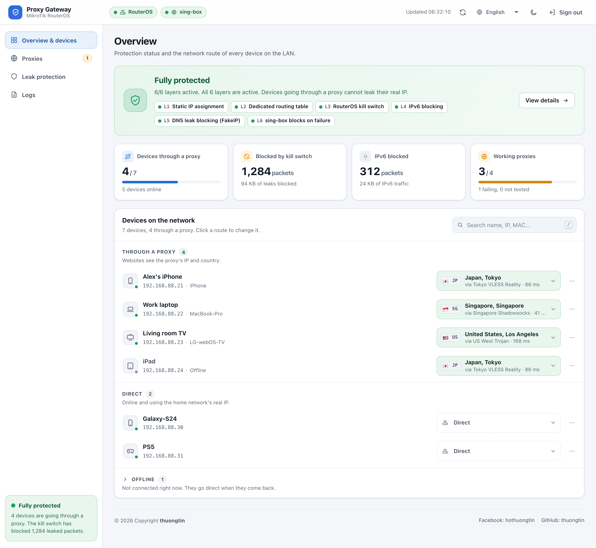
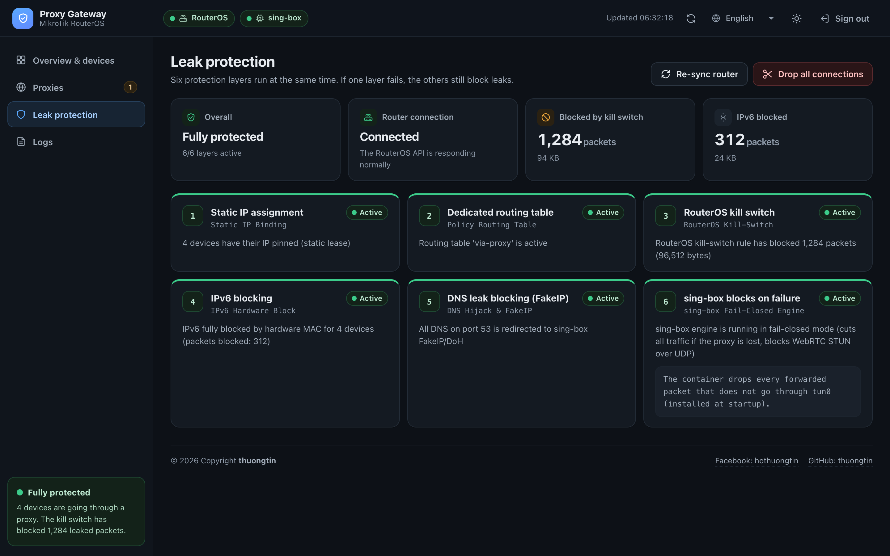
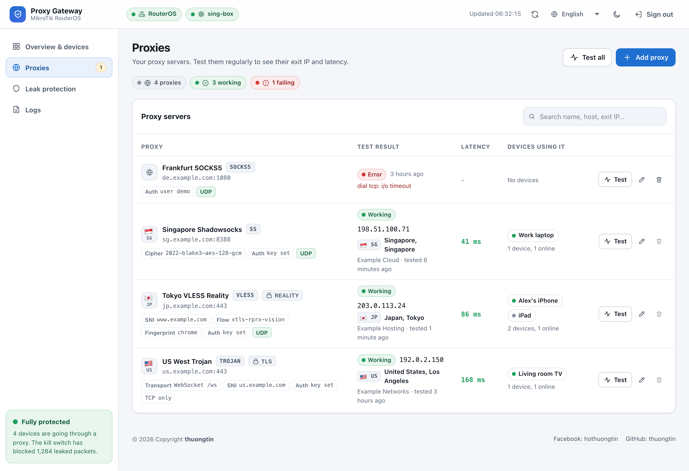
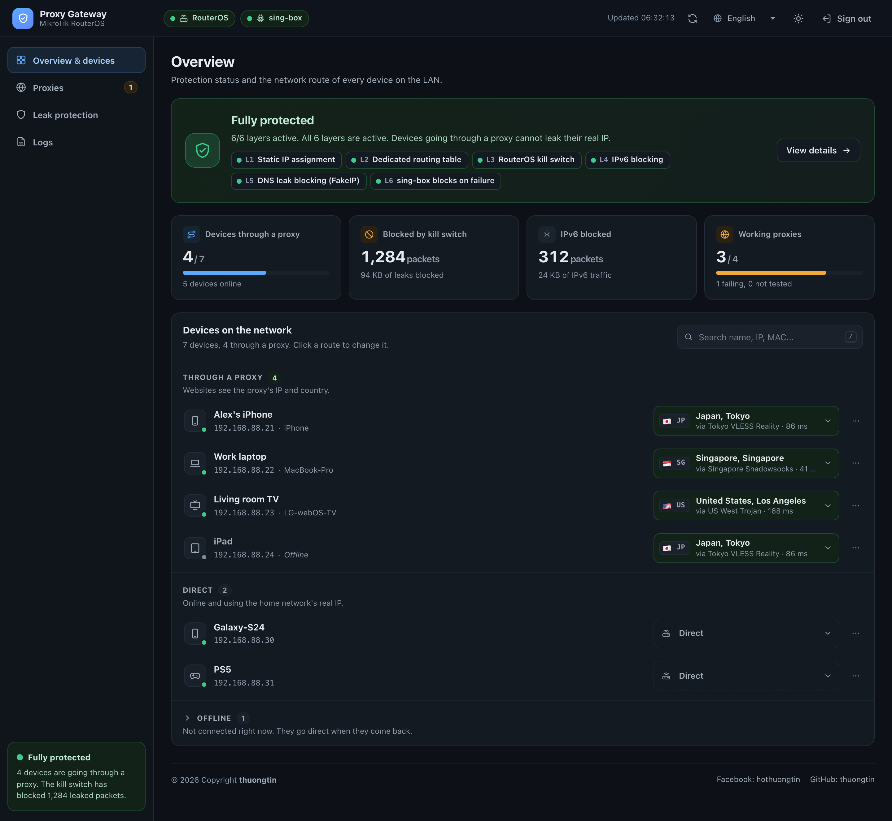
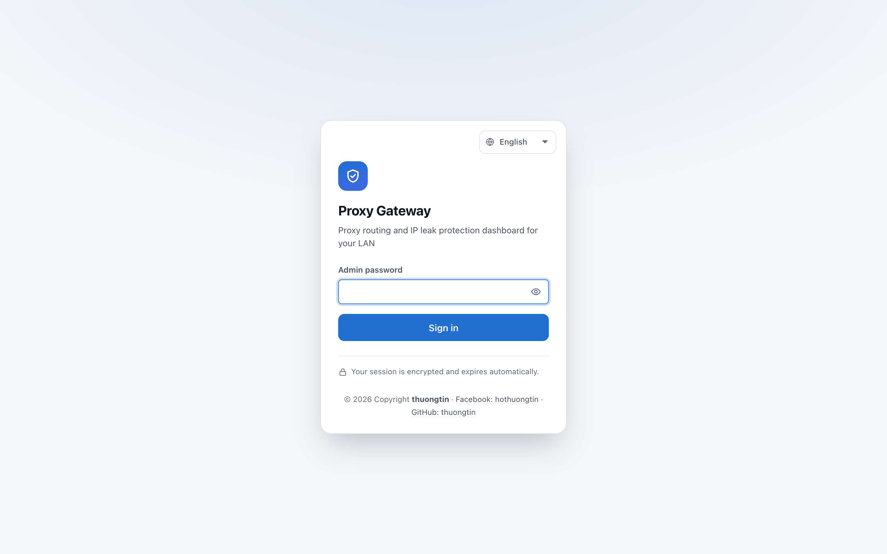
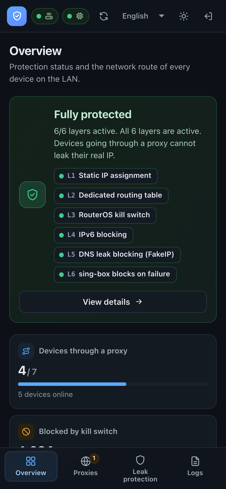

<div align="center">


# MikroTik Proxy Dashboard

Per-device proxy routing with IP leak protection for MikroTik RouterOS 7.
Runs as a container on the router itself.

**English** | [Tiếng Việt](README.vi.md) | [简体中文](README.zh-CN.md) | [Русский](README.ru.md) | [한국어](README.ko.md)

[](https://github.com/thuongtin/mikrotik-proxy-dashboard/actions/workflows/ci.yml)
[](LICENSE)

</div>

The dashboard runs in a `linux/arm64` container directly on the router (used on an RB5009UG+S+ with RouterOS 7.25). It drives `sing-box` as a transparent gateway and adds or removes rules on RouterOS through the REST API.

The goal: once a device is assigned a proxy, it can only reach the Internet through that proxy. If the proxy or the container fails, the device loses connectivity instead of exposing its real IP.

> **Project status:** suitable for home and small office networks where the LAN is trusted. A review on 2026-11-25 fixed the phase 1 weaknesses in code. Some items are still open (the dashboard is served over plain HTTP, devices that change their own IP or MAC, no periodic monitoring yet). Read [docs/security.md](docs/security.md) before deploying.

## Screenshots

<p align="center">
  
  <br><sub>Overview: protection status and the route of every device</sub>
</p>

<table>
  <tr>
    <td width="50%"><br><sub>Leak protection: the six layers</sub></td>
    <td width="50%"><br><sub>Proxies: test results, exit IP and latency</sub></td>
  </tr>
  <tr>
    <td width="50%"><br><sub>Overview in dark mode</sub></td>
    <td width="50%"><br><sub>Sign-in page</sub></td>
  </tr>
</table>

<p align="center">
  
  <br><sub>Mobile layout</sub>
</p>

All screenshots use demo data (documentation IP ranges, `example.com` hosts).

## Documentation

| Document | Read it when |
| :--- | :--- |
| [docs/routeros-setup.md](docs/routeros-setup.md) | Installing on a router for the first time, post-install checks, uninstalling |
| [docs/architecture.md](docs/architecture.md) | You want to understand the data flow, code layout and API |
| [docs/security.md](docs/security.md) | Reviewing the threat model, known weaknesses and hardening steps |
| [docs/roadmap.md](docs/roadmap.md) | Looking at planned features by phase |

The documentation is also available in Vietnamese under [docs/vi/](docs/vi/).

## How it works

```text
LAN device 10.88.88.x  (in address-list PROXY_DEVICES)
        |
        v
RouterOS
  - policy routing: mangle marks PROXY_DEVICES, table via-proxy, gateway 10.10.10.16
  - DNS hijack: every port 53 query is redirected to the container
  - kill-switch: drop packets of these devices that try to go straight to WAN
  - IPv6 blocked per MAC address
        |
        v
Container 10.10.10.16 (veth-proxy)
  - proxy-dash :8080   dashboard, REST API, RouterOS control
  - sing-box           tun0 + DNS :53 (FakeIP, DoH through the proxy), routing by source IP
  - forward guard      iptables: forwarded packets may only leave through tun0
        |
        v
The proxy assigned to the device
```

Devices without a proxy use the network directly, as usual, and are not affected by these rules.

## Features

- **7 proxy protocols:** HTTP, HTTPS, SOCKS5, Shadowsocks (SIP002 and legacy), Trojan, VLESS (Reality, Vision), VMess (WebSocket, gRPC).
- **Bulk import:** paste `socks5://`, `http://`, `https://`, `vless://`, `vmess://`, `ss://`, `trojan://` links or `host:port:user:pass`, one proxy per line.
- **Proxy testing:** starts a temporary `sing-box` process, measures latency and reads the exit IP, country and ISP.
- **Per-device assignment:** the device list comes from the router's DHCP leases and ARP table; devices can get a nickname; open connections can be cut to force them onto the new route.
- **Embedded dashboard:** English, Tiếng Việt, 简体中文, Русский, 한국어; light and dark themes; no resources loaded from the Internet.
- **Sign-in:** `bcrypt` password hash, HMAC-SHA256 signed session cookie, temporary lockout per client after repeated failed attempts.
- **Step-by-step errors:** if assigning or unassigning fails halfway, the UI says which step failed and whether the change took effect or was rolled back.

### Six layers against IP leaks

| Layer | What it does | Set up by | What the dashboard checks |
| :--- | :--- | :--- | :--- |
| L1 Static IP Binding | Pins the DHCP lease so the device IP cannot change | Dashboard, on assign | Every assigned device has a static lease with the right IP and MAC |
| L2 Policy Routing | Sends `PROXY_DEVICES` traffic to the `via-proxy` table | Manual, once | The table exists, an enabled routing rule uses it, something steers traffic into it, assigned devices are in `PROXY_DEVICES` |
| L3 Kill-Switch | Drops `PROXY_DEVICES` packets that go straight to WAN | Manual, once | The rule is enabled with the right chain, action and address list; warns when the out interface is missing or an accept rule comes first |
| L4 IPv6 Block | Rejects IPv6 by MAC address in the forward and input chains | Dashboard, on assign | Every assigned MAC has both rules, with the right MAC, not behind an accept rule |
| L5 DNS Hijack and FakeIP | Redirects port 53 to `sing-box`; answers with FakeIP and resolves through DoH over the proxy; blocks `AAAA`, `HTTPS`, `SVCB` | NAT manual, the rest generated | A `dst-nat` rule for port 53 exists for both UDP and TCP and is not shadowed by another NAT rule |
| L6 sing-box Fail-Closed | No matching rule means reject, never direct; UDP is rejected when the proxy cannot carry it (stops WebRTC STUN leaks); the forward guard drops packets that do not use `tun0` | Generated | `sing-box` is running and the forward guard is installed |

Each layer is in one of four states: OK, warning, error, or "cannot verify" when the dashboard cannot read the router. A layer that cannot be verified is never counted as OK. Details for every condition: [docs/security.md](docs/security.md).

## Quick start

1. Build the image:

   ```bash
   ./scripts/build-arm64-tar.sh
   ```

   The script runs `go vet`, `go test` and `govulncheck` in Docker before building and stops on any failure. Output: `dist/proxy-gw-arm64.tar`.

2. Create the dashboard password hash (type the password when asked):

   ```bash
   go run . --hash-password
   ```

3. Configure the router and load the container by following [docs/routeros-setup.md](docs/routeros-setup.md).

4. Open `http://10.10.10.16:8080` and check the status page: all six layers must be OK before you assign the first device. Then add a proxy, test it, and assign it to a device.

5. On the assigned device itself, check for leaks with `ipleak.net`, `browserleaks.com/dns`, `browserleaks.com/webrtc` and `test-ipv6.com`. A "protected" status on the dashboard does not replace this step.

## Configuration

All settings are read from the container's environment variables.

| Variable | Default | Meaning |
| :--- | :--- | :--- |
| `DASHBOARD_PASSWORD_HASH` | empty | bcrypt hash of the dashboard password. Required. In the RouterOS terminal, write each `$` as `\$` ([why](docs/routeros-setup.md#4-container)) |
| `MIKROTIK_URL` | `https://10.88.88.1` | RouterOS REST API address. The host must appear in the SAN of the router certificate |
| `MIKROTIK_USER` | `admin` | RouterOS account. Create a dedicated account, see the setup guide |
| `MIKROTIK_PASS` | empty | Password of that account |
| `MIKROTIK_CA_FILE` | empty | PEM file of the CA, or of the self-signed certificate itself, used to verify the router. Empty means the system CA store |
| `MIKROTIK_INSECURE_TLS` | `false` | `true` skips router certificate verification. Temporary use only; a warning is logged on every start |
| `LISTEN_ADDR` | `:8080` | Dashboard listen address |
| `DATA_DIR` | `/data` | Where `state.json`, `session.key`, `sing-box.json` and `cache.db` are stored |
| `LAN_CIDR` | `10.88.88.0/24` | LAN range that can be assigned a proxy |
| `CONTAINER_GW` | `10.10.10.1` | Container gateway, also used as the bootstrap DNS |
| `VETH_IF` | auto-detected | Container uplink interface |
| `EXCLUDE_CIDRS` | `10.88.88.0/24,10.10.10.0/24,10.77.77.0/24,192.168.0.0/16` | Destinations that bypass `tun0`; the forward guard also allows them |
| `FORWARD_GUARD` | `auto` | Forward guard in the container. `auto`: install, warn and continue if that fails. `enforce`: refuse to start if it cannot be installed. `off`: do not install |
| `SINGBOX_PATH` | `/usr/local/bin/sing-box` | Path of the `sing-box` binary |

Full example: [.env.example](.env.example).

**Upgrading from an older build:** the default of `MIKROTIK_INSECURE_TLS` changed from `true` to `false`. An old container that does not set it cannot reach the router until you set `MIKROTIK_CA_FILE` (recommended) or temporarily set `MIKROTIK_INSECURE_TLS=true` again. How to get the certificate: [docs/routeros-setup.md](docs/routeros-setup.md).

## Languages

The dashboard follows the browser language and can be switched from the language menu in the top bar or on the sign-in screen. The choice is saved in the browser and sent to the server in the `pgw_lang` cookie, so API messages (errors, leak guard results) use the same language. English is the default and the fallback for any missing text.

Translations are plain JSON files. See [CONTRIBUTING.md](CONTRIBUTING.md#translations) to fix a translation or add a language.

## Development

```bash
go test ./...
```

```bash
go vet ./...
```

```bash
node scripts/check-i18n.mjs
```

```bash
GOTOOLCHAIN=go1.27.4 go run golang.org/x/vuln/cmd/govulncheck@v1.10.0 ./...
```

The last command scans for vulnerabilities with the same Go version the image is built with. Some tests need a `sing-box` binary in `PATH`.

Test coverage: URI parsers for the 7 protocols, `sing-box` config generation, authentication and login rate limiting, the RouterOS REST client (mocked), every leak guard layer, HTTP handlers (including rollback when an assignment fails), state persistence, config loading and message catalogs. There are no frontend tests and no integration tests against a real router yet.

Code layout and API: [docs/architecture.md](docs/architecture.md). Contribution guide: [CONTRIBUTING.md](CONTRIBUTING.md).

## Known limitations

- The dashboard is served over plain HTTP. Expose it only to admin devices, never to the Internet.
- Every assign, unassign, or edit of a proxy that is in use restarts `sing-box`; connections of every proxied device drop for a few seconds. Adding, importing or deleting unassigned proxies does not.
- The forward guard needs the router kernel to allow iptables in containers. RouterOS supports this only partially; when it cannot be installed, layer L6 shows a warning and the router kill-switch is the only barrier while `sing-box` is stopped.
- IPv6 is fully blocked for proxied devices; it is not carried through the proxy.
- Phones with randomized MAC addresses (Private Wi-Fi Address) must turn that off for this network, otherwise L1 and L4 stop working when the MAC changes.
- Apps that use their own DoH or VPN are outside the control of L5.

## Security

Please report vulnerabilities privately, see [SECURITY.md](SECURITY.md).

## License

[MIT](LICENSE) © thuongtin · [GitHub](https://github.com/thuongtin) · [Facebook](https://facebook.com/hothuongtin)
