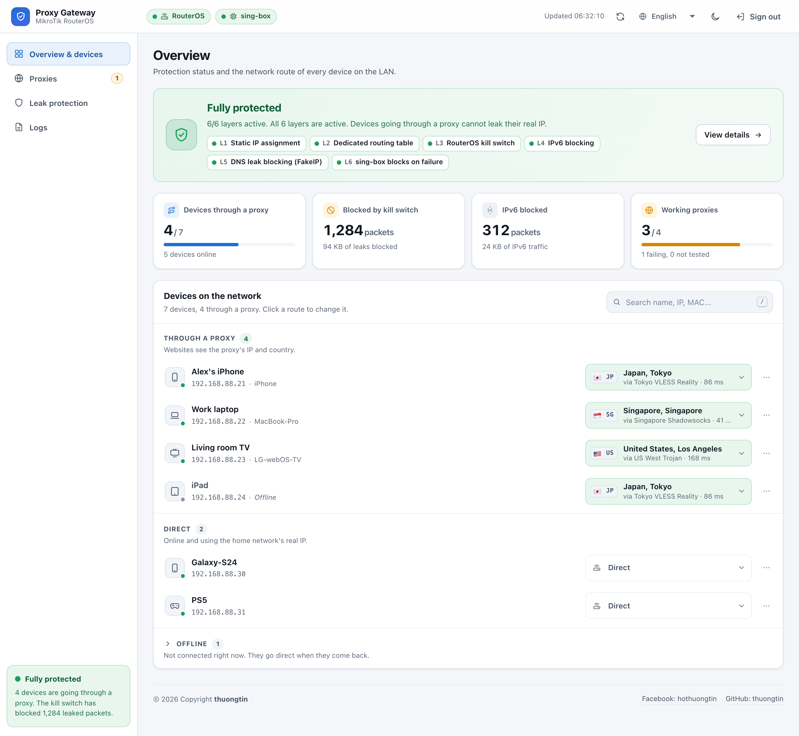
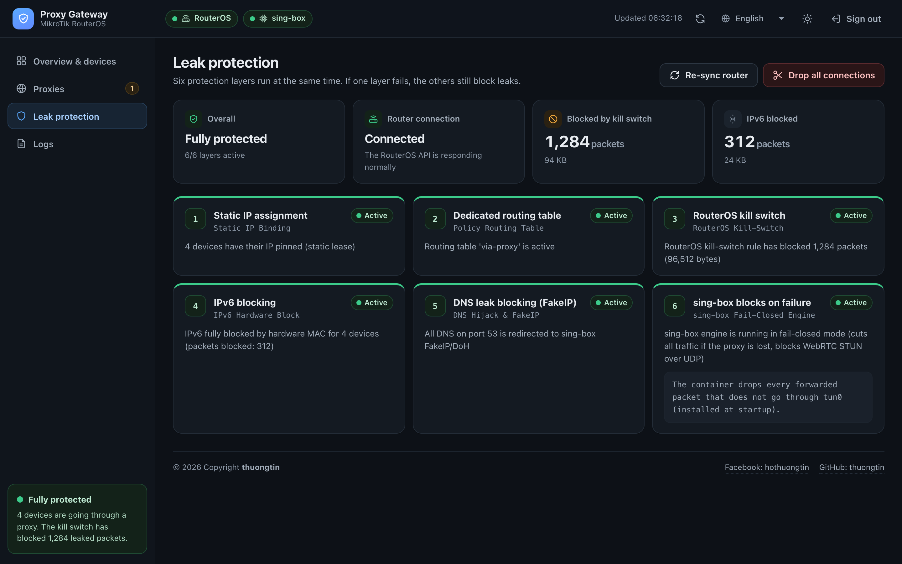
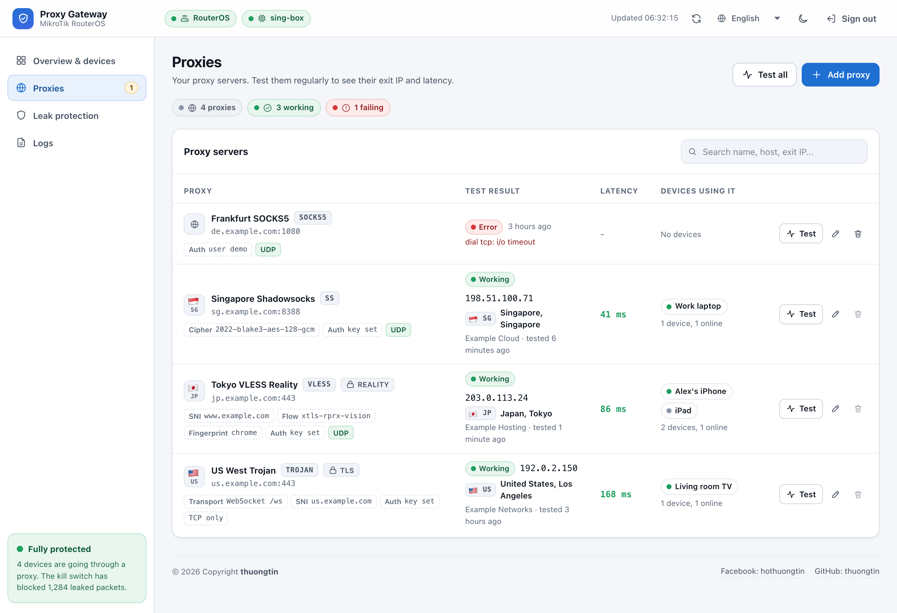
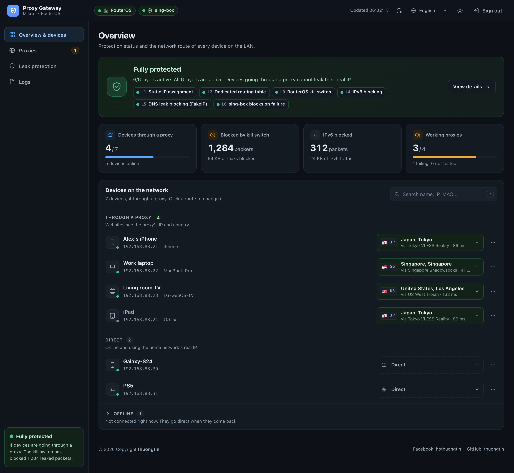
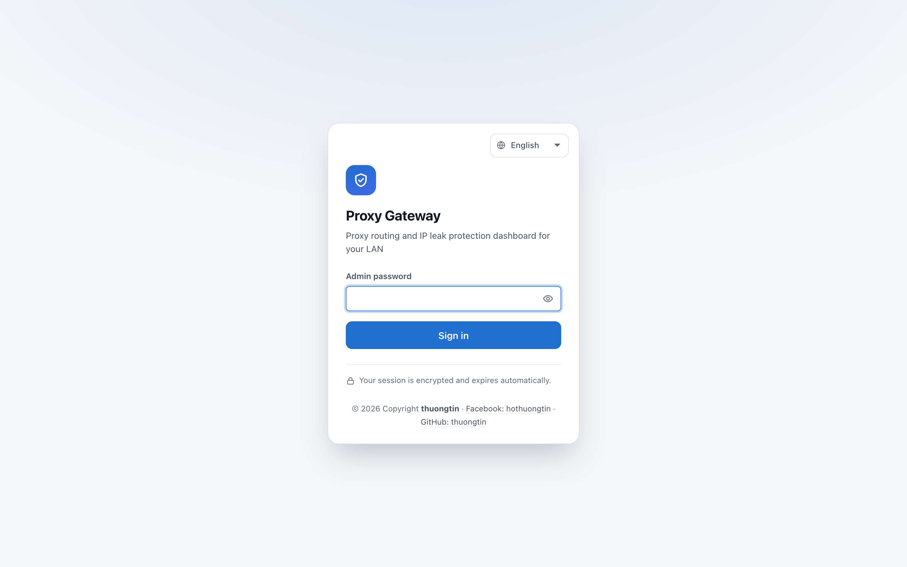
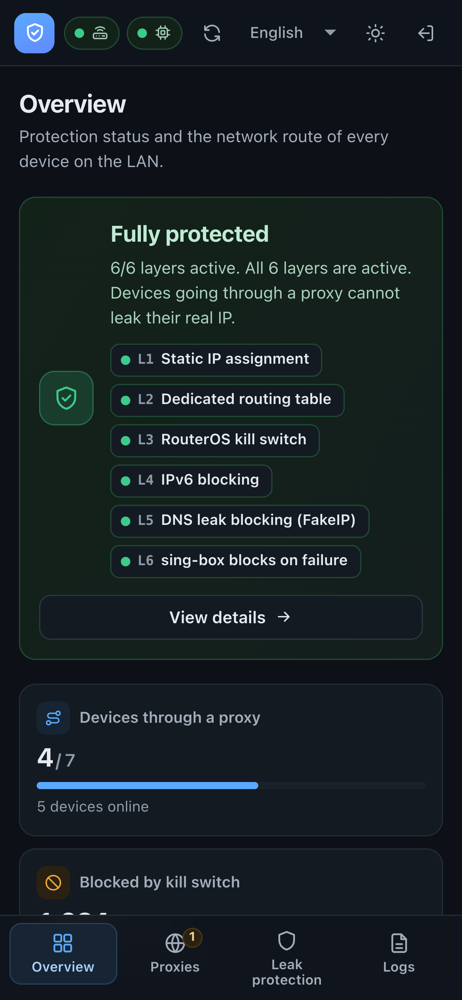

<div align="center">


# MikroTik Proxy Dashboard

Маршрутизация через прокси для каждого устройства с защитой от утечки IP для MikroTik RouterOS 7.
Работает как контейнер прямо на роутере.

[English](README.md) | [Tiếng Việt](README.vi.md) | [简体中文](README.zh-CN.md) | **Русский** | [한국어](README.ko.md)

[](https://github.com/thuongtin/mikrotik-proxy-dashboard/actions/workflows/ci.yml)
[](LICENSE)

</div>

Панель работает в контейнере `linux/arm64` прямо на роутере (используется на RB5009UG+S+ с RouterOS 7.25). Она управляет `sing-box` как прозрачным шлюзом (transparent gateway) и добавляет или удаляет правила в RouterOS через REST API.

Цель: если устройству назначен прокси, оно может выходить в Интернет только через этот прокси. Если прокси или контейнер выходит из строя, устройство теряет связь, но не раскрывает свой реальный IP.

> **Состояние проекта:** подходит для домашних сетей и небольших офисов, где LAN считается доверенной. Аудит от 2026-11-25 устранил в коде слабые места этапа 1. Некоторые вопросы ещё открыты (панель работает по обычному HTTP, устройства могут сами сменить IP или MAC, периодического мониторинга пока нет). Перед развёртыванием прочитайте [docs/security.md](docs/security.md).

## Скриншоты

<p align="center">
  
  <br><sub>Обзор: состояние защиты и маршрут каждого устройства</sub>
</p>

<table>
  <tr>
    <td width="50%"><br><sub>Защита от утечек: шесть уровней</sub></td>
    <td width="50%"><br><sub>Прокси: результаты проверки, выходной IP и задержка</sub></td>
  </tr>
  <tr>
    <td width="50%"><br><sub>Обзор в тёмной теме</sub></td>
    <td width="50%"><br><sub>Страница входа</sub></td>
  </tr>
</table>

<p align="center">
  
  <br><sub>Мобильная версия</sub>
</p>

На всех скриншотах демонстрационные данные (IP-диапазоны для документации, хосты `example.com`).

## Документация

| Документ | Когда читать |
| :--- | :--- |
| [docs/routeros-setup.md](docs/routeros-setup.md) | Первая установка на роутер, проверки после установки, удаление |
| [docs/architecture.md](docs/architecture.md) | Нужно разобраться в потоке данных, структуре кода и API |
| [docs/security.md](docs/security.md) | Изучение модели угроз, известных слабых мест и шагов по усилению защиты |
| [docs/roadmap.md](docs/roadmap.md) | Планируемые функции по этапам |

Подробная документация пока доступна только на английском и вьетнамском языках (вьетнамская версия: [docs/vi/](docs/vi/)).

## Как это работает

```text
Устройство LAN 10.88.88.x  (в address-list PROXY_DEVICES)
        |
        v
RouterOS
  - policy routing: mangle помечает PROXY_DEVICES, таблица via-proxy, шлюз 10.10.10.16
  - перехват DNS: каждый запрос на порт 53 перенаправляется в контейнер
  - kill switch: отбрасывает пакеты этих устройств, идущие напрямую в WAN
  - IPv6 блокируется по MAC-адресу
        |
        v
Контейнер 10.10.10.16 (veth-proxy)
  - proxy-dash :8080   панель, REST API, управление RouterOS
  - sing-box           tun0 + DNS :53 (FakeIP, DoH через прокси), маршрутизация по IP источника
  - forward guard      iptables: пересылаемые пакеты могут уходить только через tun0
        |
        v
Прокси, назначенный устройству
```

Устройства без прокси работают с сетью напрямую, как обычно, и эти правила их не затрагивают.

## Возможности

- **7 протоколов прокси:** HTTP, HTTPS, SOCKS5, Shadowsocks (SIP002 и legacy), Trojan, VLESS (Reality, Vision), VMess (WebSocket, gRPC).
- **Массовый импорт:** вставьте ссылки `socks5://`, `http://`, `https://`, `vless://`, `vmess://`, `ss://`, `trojan://` или строки `host:port:user:pass`, по одному прокси на строку.
- **Проверка прокси:** запускает временный процесс `sing-box`, измеряет задержку и определяет выходной IP, страну и провайдера.
- **Назначение по устройствам:** список устройств берётся из аренд DHCP и таблицы ARP роутера; устройствам можно задать понятное имя; открытые соединения можно сбросить, чтобы устройство сразу перешло на новый маршрут.
- **Встроенная панель:** English, Tiếng Việt, 简体中文, Русский, 한국어; светлая и тёмная темы; никаких ресурсов из Интернета.
- **Вход:** хеш пароля `bcrypt`, cookie сеанса с подписью HMAC-SHA256, временная блокировка клиента после нескольких неудачных попыток.
- **Ошибки по шагам:** если назначение или снятие прокси прерывается на полпути, интерфейс показывает, на каком шаге произошёл сбой и применилось ли изменение или было откачено.

### Шесть уровней защиты от утечки IP

| Уровень | Что делает | Кто настраивает | Что проверяет панель |
| :--- | :--- | :--- | :--- |
| L1 Static IP Binding | Закрепляет аренду DHCP, чтобы IP устройства не менялся | Панель, при назначении | У каждого назначенного устройства есть статическая аренда с правильными IP и MAC |
| L2 Policy Routing | Направляет трафик `PROXY_DEVICES` в таблицу `via-proxy` | Вручную, один раз | Таблица существует, её использует включённое правило маршрутизации, что-то направляет в неё трафик, назначенные устройства есть в `PROXY_DEVICES` |
| L3 Kill-Switch | Отбрасывает пакеты `PROXY_DEVICES`, идущие напрямую в WAN | Вручную, один раз | Правило включено, у него правильные chain, action и address list; предупреждение, если не задан out interface или раньше стоит правило accept |
| L4 IPv6 Block | Отклоняет IPv6 по MAC-адресу в цепочках forward и input | Панель, при назначении | Для каждого назначенного MAC есть оба правила с правильным MAC и не после правила accept |
| L5 DNS Hijack and FakeIP | Перенаправляет порт 53 в `sing-box`; отвечает через FakeIP и разрешает имена через DoH поверх прокси; блокирует `AAAA`, `HTTPS`, `SVCB` | NAT вручную, остальное генерируется | Правило `dst-nat` для порта 53 есть и для UDP, и для TCP и не перекрыто другим правилом NAT |
| L6 sing-box Fail-Closed | Если ни одно правило не подошло, соединение отклоняется, а не идёт напрямую; UDP отклоняется, когда прокси не может его передать (защита от утечек WebRTC STUN); forward guard отбрасывает пакеты, которые не проходят через `tun0` | Генерируется | `sing-box` запущен и forward guard установлен |

Каждый уровень находится в одном из четырёх состояний: OK, предупреждение, ошибка или «не удаётся проверить», когда панель не может прочитать данные с роутера. Уровень, который не удалось проверить, никогда не считается OK. Подробности по каждому условию: [docs/security.md](docs/security.md).

## Быстрый старт

1. Соберите образ:

   ```bash
   ./scripts/build-arm64-tar.sh
   ```

   Скрипт запускает `go vet`, `go test` и `govulncheck` в Docker перед сборкой и останавливается при любой ошибке. Результат: `dist/proxy-gw-arm64.tar`.

2. Создайте хеш пароля панели (введите пароль, когда появится запрос):

   ```bash
   go run . --hash-password
   ```

3. Настройте роутер и загрузите контейнер по инструкции [docs/routeros-setup.md](docs/routeros-setup.md).

4. Откройте `http://10.10.10.16:8080` и проверьте страницу состояния: все шесть уровней должны быть в состоянии OK до назначения первого устройства. Затем добавьте прокси, проверьте его и назначьте устройству.

5. На самом назначенном устройстве проверьте утечки с помощью `ipleak.net`, `browserleaks.com/dns`, `browserleaks.com/webrtc` и `test-ipv6.com`. Статус «Полная защита» в панели не заменяет этот шаг.

## Настройка

Все параметры читаются из переменных окружения контейнера.

| Переменная | По умолчанию | Назначение |
| :--- | :--- | :--- |
| `DASHBOARD_PASSWORD_HASH` | пусто | bcrypt-хеш пароля панели. Обязательно. В терминале RouterOS каждый `$` пишется как `\$` ([почему](docs/routeros-setup.md#4-container)) |
| `MIKROTIK_URL` | `https://10.88.88.1` | Адрес RouterOS REST API. Хост должен быть указан в SAN сертификата роутера |
| `MIKROTIK_USER` | `admin` | Учётная запись RouterOS. Создайте отдельную учётную запись, см. инструкцию по установке |
| `MIKROTIK_PASS` | пусто | Пароль этой учётной записи |
| `MIKROTIK_CA_FILE` | пусто | PEM-файл CA или самого самоподписанного сертификата для проверки роутера. Пусто означает системное хранилище CA |
| `MIKROTIK_INSECURE_TLS` | `false` | `true` отключает проверку сертификата роутера. Только временно; при каждом запуске в лог пишется предупреждение |
| `LISTEN_ADDR` | `:8080` | Адрес, на котором слушает панель |
| `DATA_DIR` | `/data` | Где хранятся `state.json`, `session.key`, `sing-box.json` и `cache.db` |
| `LAN_CIDR` | `10.88.88.0/24` | Диапазон LAN, которому можно назначать прокси |
| `CONTAINER_GW` | `10.10.10.1` | Шлюз контейнера, также используется как bootstrap DNS |
| `VETH_IF` | определяется автоматически | Uplink-интерфейс контейнера |
| `EXCLUDE_CIDRS` | `10.88.88.0/24,10.10.10.0/24,10.77.77.0/24,192.168.0.0/16` | Адреса назначения в обход `tun0`; forward guard их тоже пропускает |
| `FORWARD_GUARD` | `auto` | Forward guard в контейнере. `auto`: установить, при неудаче выдать предупреждение и продолжить. `enforce`: не запускаться, если установить не удалось. `off`: не устанавливать |
| `SINGBOX_PATH` | `/usr/local/bin/sing-box` | Путь к бинарному файлу `sing-box` |

Полный пример: [.env.example](.env.example).

**Обновление со старой сборки:** значение `MIKROTIK_INSECURE_TLS` по умолчанию изменилось с `true` на `false`. Старый контейнер, в котором оно не задано, не сможет подключиться к роутеру, пока вы не зададите `MIKROTIK_CA_FILE` (рекомендуется) или временно снова не установите `MIKROTIK_INSECURE_TLS=true`. Как получить сертификат: [docs/routeros-setup.md](docs/routeros-setup.md).

## Языки

Панель использует язык браузера, его можно сменить в меню языка на верхней панели или на экране входа. Выбор сохраняется в браузере и передаётся серверу в cookie `pgw_lang`, поэтому сообщения API (ошибки, результаты проверки защиты от утечек) приходят на том же языке. Английский используется по умолчанию и для любого непереведённого текста.

Переводы хранятся в обычных JSON-файлах. Чтобы исправить перевод или добавить язык, см. [CONTRIBUTING.md](CONTRIBUTING.md#translations).

## Разработка

```bash
go test ./...
```

```bash
go vet ./...
```

```bash
node scripts/check-i18n.mjs
```

```bash
GOTOOLCHAIN=go1.27.4 go run golang.org/x/vuln/cmd/govulncheck@v1.10.0 ./...
```

Последняя команда ищет уязвимости с той же версией Go, с которой собирается образ. Некоторым тестам нужен бинарный файл `sing-box` в `PATH`.

Покрытие тестами: парсеры URI для 7 протоколов, генерация конфигурации `sing-box`, аутентификация и ограничение частоты входа, клиент RouterOS REST (с моками), все уровни защиты от утечек, HTTP-обработчики (включая откат при неудачном назначении), сохранение состояния, загрузка конфигурации и каталоги сообщений. Тестов фронтенда и интеграционных тестов на реальном роутере пока нет.

Структура кода и API: [docs/architecture.md](docs/architecture.md). Руководство для участников: [CONTRIBUTING.md](CONTRIBUTING.md).

## Известные ограничения

- Панель работает по обычному HTTP. Открывайте к ней доступ только с устройств администратора и никогда из Интернета.
- Каждое назначение, снятие назначения или изменение используемого прокси перезапускает `sing-box`; соединения всех устройств, работающих через прокси, обрываются на несколько секунд. Добавление, импорт или удаление неназначенных прокси на это не влияет.
- Для forward guard ядро роутера должно разрешать iptables в контейнерах. RouterOS поддерживает это лишь частично; если установить его не удалось, уровень L6 показывает предупреждение, и пока `sing-box` остановлен, единственным барьером остаётся kill switch роутера.
- IPv6 полностью блокируется для устройств, работающих через прокси; через прокси он не передаётся.
- На телефонах со случайным MAC-адресом (частный адрес Wi-Fi) эту функцию нужно отключить для данной сети, иначе L1 и L4 перестанут работать при смене MAC.
- Приложения со своим DoH или VPN находятся вне контроля L5.

## Безопасность

Об уязвимостях сообщайте конфиденциально, см. [SECURITY.md](SECURITY.md).

## Лицензия

[MIT](LICENSE) © thuongtin · [GitHub](https://github.com/thuongtin) · [Facebook](https://facebook.com/hothuongtin)
