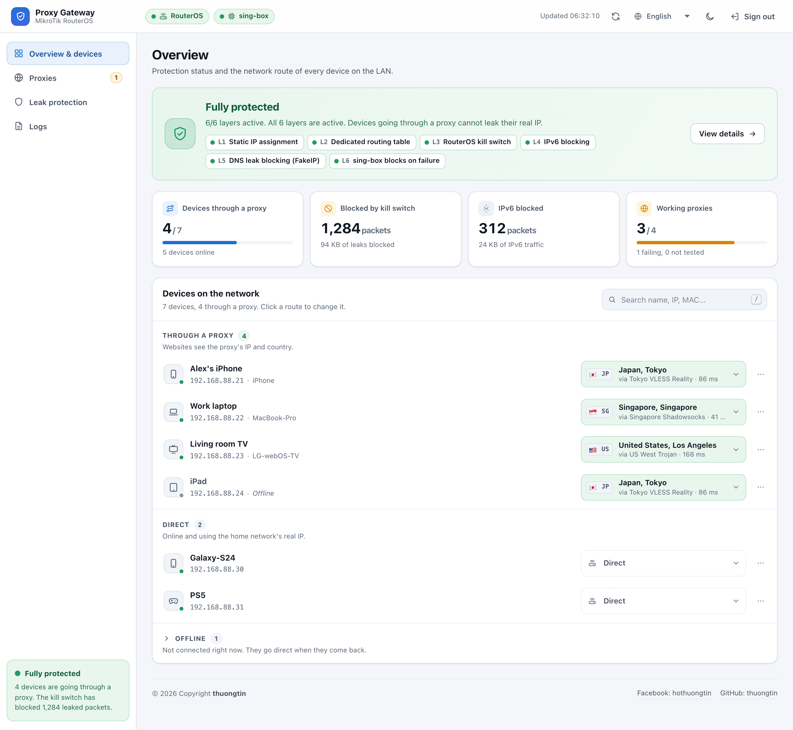
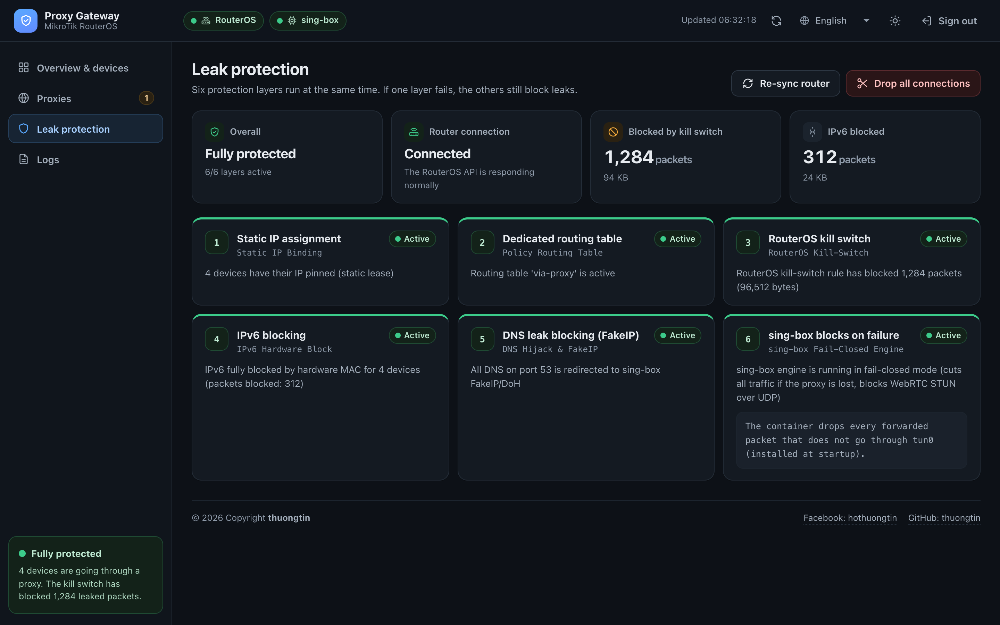
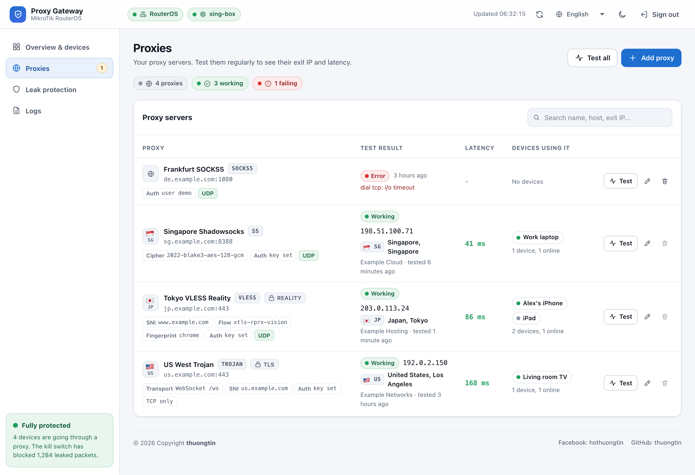
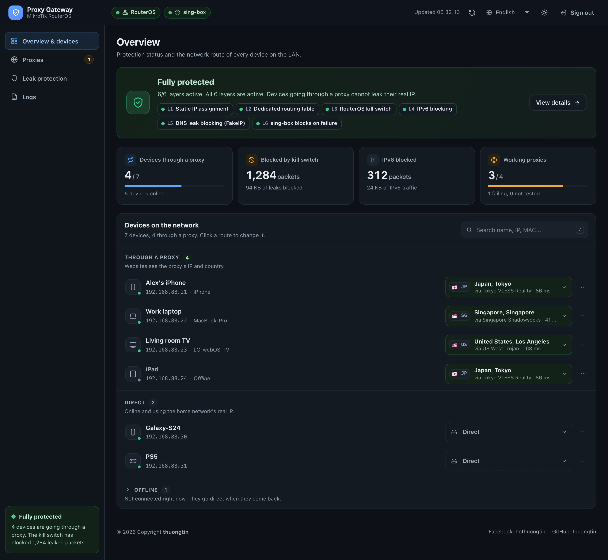
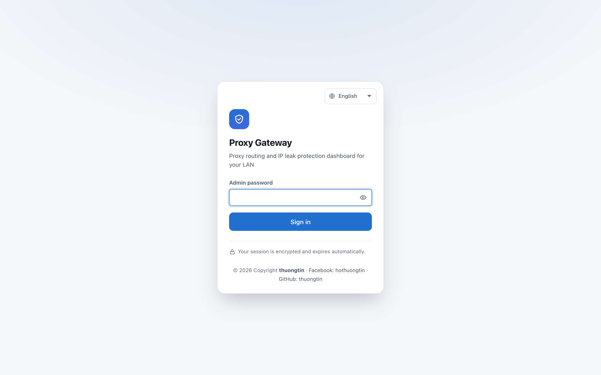
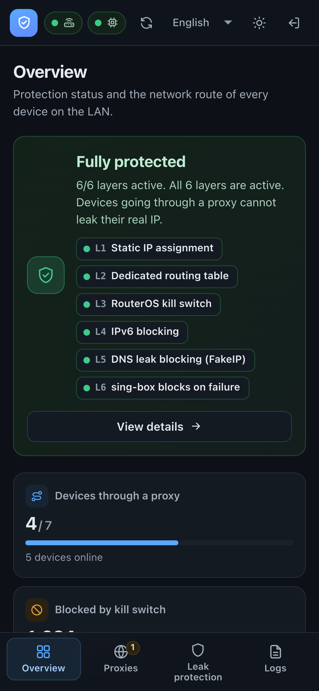

<div align="center">


# MikroTik Proxy Dashboard

Gán proxy riêng cho từng thiết bị, có chống lộ IP, dành cho MikroTik RouterOS 7.
Chạy dưới dạng container ngay trên router.

[English](README.md) | **Tiếng Việt** | [简体中文](README.zh-CN.md) | [Русский](README.ru.md) | [한국어](README.ko.md)

[](https://github.com/thuongtin/mikrotik-proxy-dashboard/actions/workflows/ci.yml)
[](LICENSE)

</div>

Dashboard chạy trong container `linux/arm64` ngay trên router (đang dùng trên RB5009UG+S+, RouterOS 7.25). Nó điều khiển `sing-box` làm cổng trong suốt (transparent gateway) và thêm, gỡ rule trên RouterOS qua REST API.

Mục tiêu: khi một thiết bị đã được gán proxy, thiết bị đó chỉ ra được Internet qua proxy ấy. Nếu proxy hoặc container gặp sự cố, thiết bị sẽ mất mạng chứ không lộ IP thật.

> **Tình trạng dự án:** phù hợp cho mạng gia đình và văn phòng nhỏ, nơi mạng LAN là tin cậy. Đợt rà soát ngày 2026-11-25 đã vá các điểm yếu giai đoạn 1 trong code. Một số việc vẫn còn mở (dashboard chạy HTTP thường, thiết bị tự đổi IP hoặc MAC, chưa có giám sát định kỳ). Đọc [docs/vi/security.md](docs/vi/security.md) trước khi triển khai.

## Ảnh chụp màn hình

<p align="center">
  
  <br><sub>Tổng quan: trạng thái bảo vệ và đường đi của từng thiết bị</sub>
</p>

<table>
  <tr>
    <td width="50%"><br><sub>Chống rò rỉ: sáu lớp bảo vệ</sub></td>
    <td width="50%"><br><sub>Proxy: kết quả kiểm tra, IP thoát và độ trễ</sub></td>
  </tr>
  <tr>
    <td width="50%"><br><sub>Tổng quan ở chế độ tối</sub></td>
    <td width="50%"><br><sub>Trang đăng nhập</sub></td>
  </tr>
</table>

<p align="center">
  
  <br><sub>Giao diện điện thoại</sub>
</p>

Mọi ảnh chụp đều dùng dữ liệu demo (dải IP dành cho tài liệu, host `example.com`).

## Tài liệu

| Tài liệu | Đọc khi |
| :--- | :--- |
| [docs/vi/routeros-setup.md](docs/vi/routeros-setup.md) | Cài lên router lần đầu, kiểm tra sau khi cài, gỡ cài đặt |
| [docs/vi/architecture.md](docs/vi/architecture.md) | Muốn hiểu luồng dữ liệu, cấu trúc code và API |
| [docs/vi/security.md](docs/vi/security.md) | Xem mô hình đe dọa, điểm yếu đã biết và các bước gia cố |
| [docs/vi/roadmap.md](docs/vi/roadmap.md) | Xem tính năng dự kiến theo từng giai đoạn |

Bản tiếng Anh của tài liệu nằm trong [docs/](docs/).

## Cách hoạt động

```text
Thiết bị LAN 10.88.88.x  (nằm trong address-list PROXY_DEVICES)
        |
        v
RouterOS
  - policy routing: mangle đánh dấu PROXY_DEVICES, bảng via-proxy, gateway 10.10.10.16
  - DNS hijack: mọi truy vấn cổng 53 được chuyển về container
  - kill-switch: chặn gói tin của các thiết bị này nếu đi thẳng ra WAN
  - chặn IPv6 theo từng địa chỉ MAC
        |
        v
Container 10.10.10.16 (veth-proxy)
  - proxy-dash :8080   dashboard, REST API, điều khiển RouterOS
  - sing-box           tun0 + DNS :53 (FakeIP, DoH đi qua proxy), định tuyến theo IP nguồn
  - forward guard      iptables: gói tin chuyển tiếp chỉ được đi ra qua tun0
        |
        v
Proxy đã gán cho thiết bị
```

Thiết bị chưa gán proxy vẫn dùng mạng trực tiếp như bình thường và không bị các rule này ảnh hưởng.

## Tính năng

- **7 giao thức proxy:** HTTP, HTTPS, SOCKS5, Shadowsocks (SIP002 và dạng cũ), Trojan, VLESS (Reality, Vision), VMess (WebSocket, gRPC).
- **Nhập hàng loạt:** dán link `socks5://`, `http://`, `https://`, `vless://`, `vmess://`, `ss://`, `trojan://` hoặc dạng `host:port:user:pass`, mỗi dòng một proxy.
- **Kiểm tra proxy:** chạy một tiến trình `sing-box` tạm, đo độ trễ và đọc IP đầu ra, quốc gia, nhà mạng.
- **Gán theo thiết bị:** danh sách thiết bị lấy từ DHCP lease và bảng ARP của router; đặt được tên gợi nhớ; cắt được các kết nối đang mở để thiết bị chuyển ngay sang đường mới.
- **Dashboard nhúng sẵn:** English, Tiếng Việt, 简体中文, Русский, 한국어; giao diện sáng và tối; không tải tài nguyên nào từ Internet.
- **Đăng nhập:** mật khẩu băm bằng `bcrypt`, cookie phiên ký HMAC-SHA256, tạm khóa theo từng máy khách sau nhiều lần nhập sai.
- **Báo lỗi theo từng bước:** nếu gán hoặc bỏ gán bị hỏng giữa chừng, giao diện cho biết bước nào lỗi và thay đổi đã có hiệu lực hay đã được hoàn tác.

### Sáu lớp chống lộ IP

| Lớp | Tác dụng | Ai thiết lập | Dashboard kiểm tra gì |
| :--- | :--- | :--- | :--- |
| L1 Static IP Binding | Cố định DHCP lease để IP thiết bị không đổi | Dashboard, khi gán | Mọi thiết bị đã gán đều có lease tĩnh với đúng IP và MAC |
| L2 Policy Routing | Đưa lưu lượng `PROXY_DEVICES` vào bảng `via-proxy` | Làm tay, một lần | Bảng tồn tại, có routing rule đang bật dùng bảng đó, có cơ chế đẩy lưu lượng vào bảng, thiết bị đã gán nằm trong `PROXY_DEVICES` |
| L3 Kill-Switch | Chặn gói tin `PROXY_DEVICES` đi thẳng ra WAN | Làm tay, một lần | Rule đang bật với đúng chain, action và address list; cảnh báo khi thiếu out interface hoặc có rule accept đứng trước |
| L4 IPv6 Block | Từ chối IPv6 theo địa chỉ MAC ở chain forward và input | Dashboard, khi gán | Mọi MAC đã gán đều có đủ hai rule, đúng MAC, không nằm sau rule accept |
| L5 DNS Hijack và FakeIP | Chuyển cổng 53 về `sing-box`; trả lời bằng FakeIP và phân giải qua DoH đi trong proxy; chặn `AAAA`, `HTTPS`, `SVCB` | NAT làm tay, phần còn lại tự sinh | Có rule `dst-nat` cho cổng 53 cả UDP lẫn TCP và không bị rule NAT khác che mất |
| L6 sing-box Fail-Closed | Không khớp rule nào thì từ chối, không bao giờ đi thẳng; từ chối UDP khi proxy không chở được (chặn lộ IP qua WebRTC STUN); forward guard chặn gói tin không đi qua `tun0` | Tự sinh | `sing-box` đang chạy và forward guard đã được cài |

Mỗi lớp có một trong bốn trạng thái: OK, cảnh báo, lỗi, hoặc "không kiểm tra được" khi dashboard không đọc được router. Lớp không kiểm tra được thì không bao giờ được tính là OK. Chi tiết từng điều kiện: [docs/vi/security.md](docs/vi/security.md).

## Bắt đầu nhanh

1. Build image:

   ```bash
   ./scripts/build-arm64-tar.sh
   ```

   Script chạy `go vet`, `go test` và `govulncheck` trong Docker trước khi build, gặp lỗi là dừng. Kết quả: `dist/proxy-gw-arm64.tar`.

2. Tạo mã băm mật khẩu dashboard (gõ mật khẩu khi được hỏi):

   ```bash
   go run . --hash-password
   ```

3. Cấu hình router và nạp container theo [docs/vi/routeros-setup.md](docs/vi/routeros-setup.md).

4. Mở `http://10.10.10.16:8080` và xem trang trạng thái: cả sáu lớp phải OK trước khi gán thiết bị đầu tiên. Sau đó thêm proxy, kiểm tra proxy, rồi gán cho thiết bị.

5. Ngay trên thiết bị đã gán, kiểm tra rò rỉ bằng `ipleak.net`, `browserleaks.com/dns`, `browserleaks.com/webrtc` và `test-ipv6.com`. Trạng thái "đã bảo vệ" trên dashboard không thay thế được bước này.

## Cấu hình

Mọi thiết lập được đọc từ biến môi trường của container.

| Biến | Mặc định | Ý nghĩa |
| :--- | :--- | :--- |
| `DASHBOARD_PASSWORD_HASH` | rỗng | Mã băm bcrypt của mật khẩu dashboard. Bắt buộc. Trong terminal RouterOS, viết mỗi `$` thành `\$` ([lý do](docs/vi/routeros-setup.md#4-container)) |
| `MIKROTIK_URL` | `https://10.88.88.1` | Địa chỉ REST API của RouterOS. Host phải có trong SAN của chứng chỉ router |
| `MIKROTIK_USER` | `admin` | Tài khoản RouterOS. Nên tạo tài khoản riêng, xem hướng dẫn cài đặt |
| `MIKROTIK_PASS` | rỗng | Mật khẩu của tài khoản đó |
| `MIKROTIK_CA_FILE` | rỗng | File PEM của CA, hoặc của chính chứng chỉ tự ký, dùng để xác thực router. Để trống thì dùng kho CA của hệ thống |
| `MIKROTIK_INSECURE_TLS` | `false` | `true` thì bỏ qua xác thực chứng chỉ router. Chỉ dùng tạm; mỗi lần khởi động sẽ ghi cảnh báo vào log |
| `LISTEN_ADDR` | `:8080` | Địa chỉ dashboard lắng nghe |
| `DATA_DIR` | `/data` | Nơi lưu `state.json`, `session.key`, `sing-box.json` và `cache.db` |
| `LAN_CIDR` | `10.88.88.0/24` | Dải LAN được phép gán proxy |
| `CONTAINER_GW` | `10.10.10.1` | Gateway của container, đồng thời là DNS khởi động |
| `VETH_IF` | tự phát hiện | Interface đi ra của container |
| `EXCLUDE_CIDRS` | `10.88.88.0/24,10.10.10.0/24,10.77.77.0/24,192.168.0.0/16` | Các đích đi thẳng, không qua `tun0`; forward guard cũng cho phép các đích này |
| `FORWARD_GUARD` | `auto` | Forward guard trong container. `auto`: cài, nếu không cài được thì cảnh báo và chạy tiếp. `enforce`: không khởi động nếu không cài được. `off`: không cài |
| `SINGBOX_PATH` | `/usr/local/bin/sing-box` | Đường dẫn tới binary `sing-box` |

Ví dụ đầy đủ: [.env.example](.env.example).

**Nâng cấp từ bản build cũ:** giá trị mặc định của `MIKROTIK_INSECURE_TLS` đã đổi từ `true` sang `false`. Container cũ không đặt biến này sẽ không kết nối được router cho tới khi bạn đặt `MIKROTIK_CA_FILE` (khuyến nghị) hoặc tạm đặt lại `MIKROTIK_INSECURE_TLS=true`. Cách lấy chứng chỉ: [docs/vi/routeros-setup.md](docs/vi/routeros-setup.md).

## Ngôn ngữ

Dashboard tự theo ngôn ngữ của trình duyệt, và đổi được từ menu ngôn ngữ ở thanh trên cùng hoặc ở màn hình đăng nhập. Lựa chọn được lưu trong trình duyệt và gửi lên server qua cookie `pgw_lang`, nên thông điệp từ API (lỗi, kết quả kiểm tra chống lộ IP) cũng dùng cùng ngôn ngữ. Tiếng Anh là mặc định và là ngôn ngữ dự phòng cho mọi đoạn chưa dịch.

Bản dịch là các file JSON thuần. Xem [CONTRIBUTING.md](CONTRIBUTING.md#translations) để sửa bản dịch hoặc thêm ngôn ngữ mới.

## Phát triển

```bash
go test ./...
```

```bash
go vet ./...
```

```bash
node scripts/check-i18n.mjs
```

```bash
GOTOOLCHAIN=go1.27.4 go run golang.org/x/vuln/cmd/govulncheck@v1.10.0 ./...
```

Lệnh cuối quét lỗ hổng bằng đúng phiên bản Go dùng để build image. Một số test cần binary `sing-box` trong `PATH`.

Phạm vi test: bộ phân tích URI của 7 giao thức, sinh cấu hình `sing-box`, xác thực và giới hạn số lần đăng nhập, REST client của RouterOS (giả lập), từng lớp chống lộ IP, HTTP handler (gồm cả hoàn tác khi gán thất bại), lưu trạng thái, nạp cấu hình và bộ thông điệp đa ngôn ngữ. Chưa có test cho frontend và chưa có test tích hợp với router thật.

Cấu trúc code và API: [docs/vi/architecture.md](docs/vi/architecture.md). Hướng dẫn đóng góp: [CONTRIBUTING.md](CONTRIBUTING.md).

## Giới hạn đã biết

- Dashboard chạy HTTP thường. Chỉ mở cho thiết bị của quản trị viên, không bao giờ mở ra Internet.
- Mỗi lần gán, bỏ gán hoặc sửa một proxy đang được dùng sẽ khởi động lại `sing-box`; kết nối của mọi thiết bị đang đi proxy bị ngắt vài giây. Thêm, nhập hoặc xóa proxy chưa gán thì không.
- Forward guard cần kernel của router cho phép iptables trong container. RouterOS chỉ hỗ trợ một phần; khi không cài được, lớp L6 hiện cảnh báo và kill-switch trên router là rào chắn duy nhất trong lúc `sing-box` dừng.
- IPv6 bị chặn hoàn toàn với thiết bị đi proxy; IPv6 không được chở qua proxy.
- Điện thoại dùng địa chỉ MAC ngẫu nhiên (Private Wi-Fi Address) phải tắt tính năng này cho mạng này, nếu không L1 và L4 sẽ mất tác dụng khi MAC thay đổi.
- Ứng dụng tự dùng DoH hoặc VPN riêng nằm ngoài tầm kiểm soát của L5.

## Bảo mật

Vui lòng báo lỗ hổng một cách riêng tư, xem [SECURITY.md](SECURITY.md).

## Giấy phép

[MIT](LICENSE) © thuongtin · [GitHub](https://github.com/thuongtin) · [Facebook](https://facebook.com/hothuongtin)
