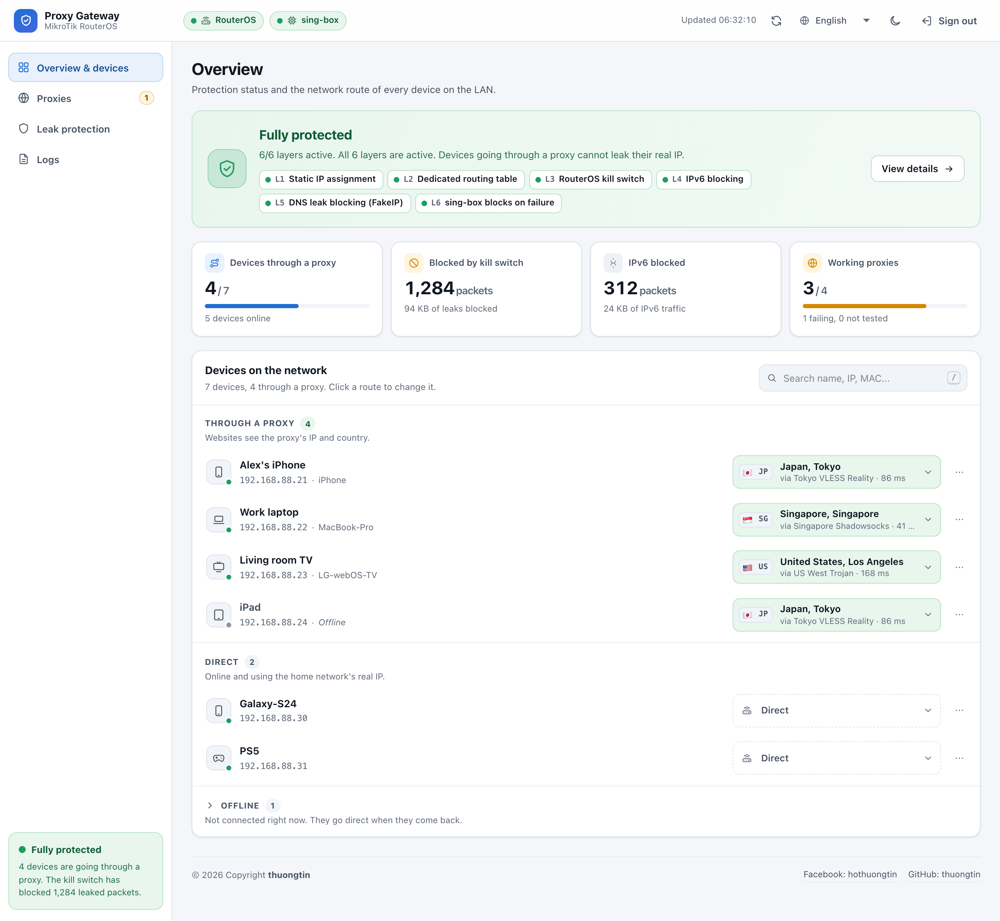
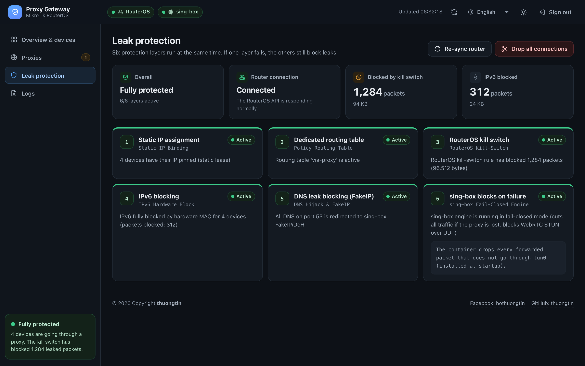
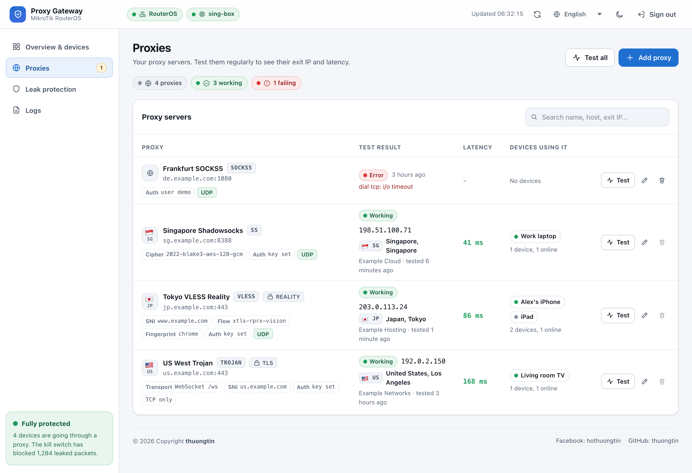
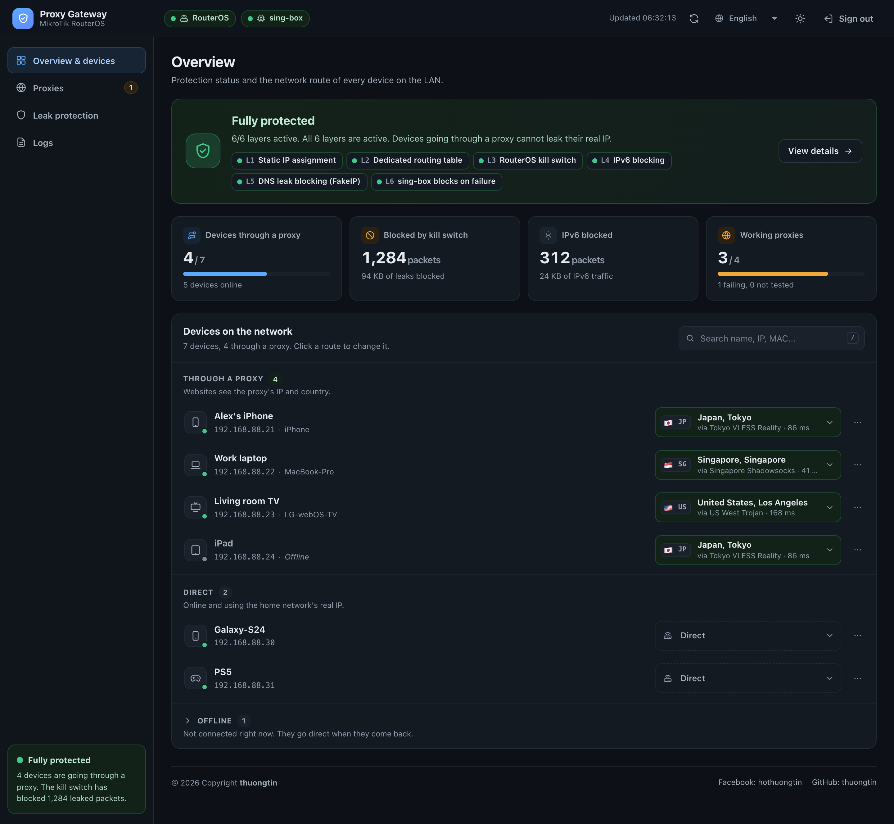
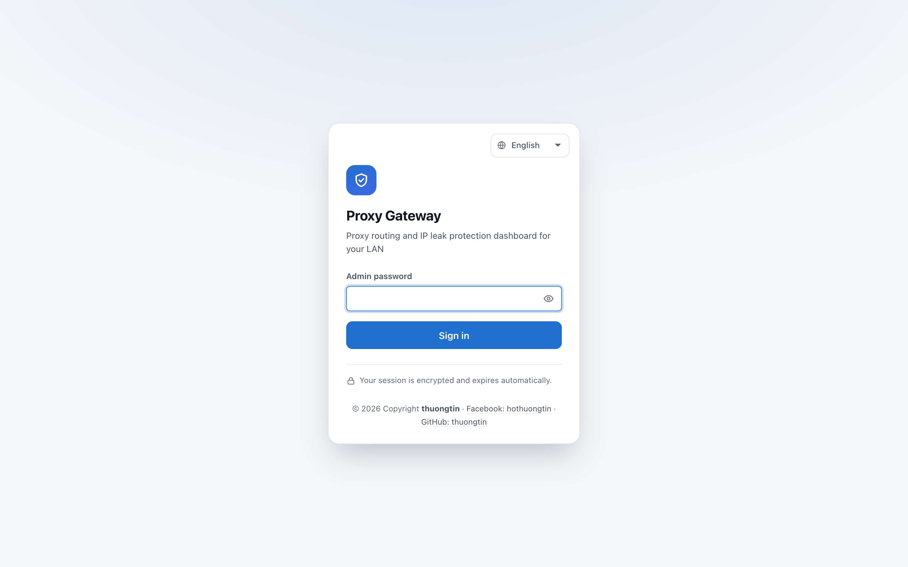
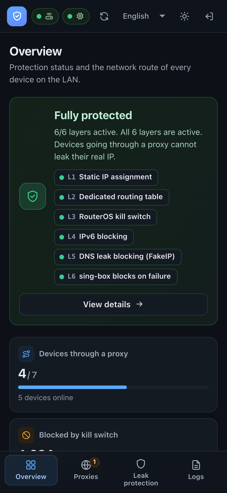

<div align="center">


# MikroTik Proxy Dashboard

为 MikroTik RouterOS 7 提供按设备分配的代理路由，并防止 IP 泄漏。
以容器形式直接运行在路由器上。

[English](README.md) | [Tiếng Việt](README.vi.md) | **简体中文** | [Русский](README.ru.md) | [한국어](README.ko.md)

[](https://github.com/thuongtin/mikrotik-proxy-dashboard/actions/workflows/ci.yml)
[](LICENSE)

</div>

Dashboard 运行在路由器上的 `linux/arm64` 容器中（实际使用环境为 RB5009UG+S+，RouterOS 7.25）。它驱动 `sing-box` 作为透明网关，并通过 REST API 在 RouterOS 上添加或删除规则。

目标：设备一旦分配了代理，就只能通过该代理访问互联网。如果代理或容器出现故障，设备会断网，而不会暴露真实 IP。

> **项目状态：** 适用于局域网可信的家庭和小型办公网络。2026-11-25 的一次审查已在代码中修复了第 1 阶段的薄弱点。仍有一些问题尚未解决（Dashboard 通过明文 HTTP 提供服务、设备自行更改 IP 或 MAC、尚无定期监控）。部署前请阅读 [docs/security.md](docs/security.md)。

## 截图

<p align="center">
  
  <br><sub>概览：防护状态以及每台设备的路由</sub>
</p>

<table>
  <tr>
    <td width="50%"><br><sub>防泄漏：六层防护</sub></td>
    <td width="50%"><br><sub>代理：测试结果、出口 IP 和延迟</sub></td>
  </tr>
  <tr>
    <td width="50%"><br><sub>深色模式下的概览</sub></td>
    <td width="50%"><br><sub>登录页</sub></td>
  </tr>
</table>

<p align="center">
  
  <br><sub>手机布局</sub>
</p>

所有截图均使用演示数据（文档专用 IP 段，`example.com` 主机）。

## 文档

| 文档 | 何时阅读 |
| :--- | :--- |
| [docs/routeros-setup.md](docs/routeros-setup.md) | 首次在路由器上安装、安装后检查、卸载 |
| [docs/architecture.md](docs/architecture.md) | 想了解数据流、代码结构和 API |
| [docs/security.md](docs/security.md) | 查看威胁模型、已知薄弱点和加固步骤 |
| [docs/roadmap.md](docs/roadmap.md) | 查看按阶段规划的功能 |

详细文档目前只有英文版和越南语版（越南语版位于 [docs/vi/](docs/vi/)）。

## 工作原理

```text
局域网设备 10.88.88.x （位于 address-list PROXY_DEVICES）
        |
        v
RouterOS
  - policy routing: mangle 标记 PROXY_DEVICES，路由表 via-proxy，网关 10.10.10.16
  - DNS hijack: 所有端口 53 的查询都被重定向到容器
  - kill-switch: 丢弃这些设备试图直接发往 WAN 的数据包
  - 按 MAC 地址阻断 IPv6
        |
        v
Container 10.10.10.16 (veth-proxy)
  - proxy-dash :8080   Dashboard、REST API、控制 RouterOS
  - sing-box           tun0 + DNS :53（FakeIP，经代理走 DoH），按源 IP 路由
  - forward guard      iptables: 转发的数据包只能从 tun0 离开
        |
        v
分配给该设备的代理
```

未分配代理的设备照常直接上网，不受这些规则影响。

## 功能

- **7 种代理协议：** HTTP、HTTPS、SOCKS5、Shadowsocks（SIP002 及旧格式）、Trojan、VLESS（Reality、Vision）、VMess（WebSocket、gRPC）。
- **批量导入：** 粘贴 `socks5://`、`http://`、`https://`、`vless://`、`vmess://`、`ss://`、`trojan://` 链接或 `host:port:user:pass`，每行一个代理。
- **代理测试：** 启动临时 `sing-box` 进程，测量延迟并读取出口 IP、国家和 ISP。
- **按设备分配：** 设备列表来自路由器的 DHCP 租约和 ARP 表；可为设备设置备注名；可断开设备当前打开的连接，使其改走新路由。
- **内嵌 Dashboard：** 支持 English、Tiếng Việt、简体中文、Русский、한국어；浅色和深色主题；不从互联网加载任何资源。
- **登录：** `bcrypt` 密码哈希、HMAC-SHA256 签名的会话 cookie，多次登录失败后按客户端临时锁定。
- **分步错误提示：** 如果分配或取消分配中途失败，界面会说明失败的步骤，以及更改是已生效还是已回滚。

### 六层 IP 防泄漏

| 层 | 作用 | 由谁配置 | Dashboard 检查什么 |
| :--- | :--- | :--- | :--- |
| L1 静态 IP 绑定（Static IP Binding） | 固定 DHCP 租约，使设备 IP 不会变化 | Dashboard，分配时 | 每台已分配设备都有 IP 和 MAC 正确的静态租约 |
| L2 策略路由（Policy Routing） | 将 `PROXY_DEVICES` 的流量送入 `via-proxy` 路由表 | 手动，一次 | 路由表存在，有已启用的 routing rule 使用它，有规则把流量导入该表，已分配设备都在 `PROXY_DEVICES` 中 |
| L3 Kill Switch | 丢弃 `PROXY_DEVICES` 中直接发往 WAN 的数据包 | 手动，一次 | 规则已启用，chain、action 和 address list 正确；缺少出接口限制或前面有 accept 规则时发出警告 |
| L4 IPv6 阻断（IPv6 Block） | 在 forward 和 input chain 中按 MAC 地址拒绝 IPv6 | Dashboard，分配时 | 每个已分配的 MAC 都有这两条规则，MAC 正确，且不在 accept 规则之后 |
| L5 DNS 劫持与 FakeIP（DNS Hijack and FakeIP） | 将端口 53 重定向到 `sing-box`；以 FakeIP 应答，并经代理通过 DoH 解析；阻断 `AAAA`、`HTTPS`、`SVCB` | NAT 手动，其余自动生成 | UDP 和 TCP 都有针对端口 53 的 `dst-nat` 规则，且未被其他 NAT 规则遮蔽 |
| L6 sing-box Fail-Closed | 没有匹配规则时拒绝，绝不直连；代理无法承载 UDP 时拒绝 UDP（防止 WebRTC STUN 泄漏）；转发防护丢弃不经过 `tun0` 的数据包 | 自动生成 | `sing-box` 正在运行，且转发防护已安装 |

每一层处于四种状态之一：生效、警告、错误，或在 Dashboard 读不到路由器时显示“未知”（无法验证）。无法验证的层永远不会被算作生效。各项条件的详细说明：[docs/security.md](docs/security.md)。

## 快速开始

1. 构建镜像：

   ```bash
   ./scripts/build-arm64-tar.sh
   ```

   脚本会在构建前于 Docker 中运行 `go vet`、`go test` 和 `govulncheck`，任何一步失败都会停止。输出：`dist/proxy-gw-arm64.tar`。

2. 生成 Dashboard 密码哈希（按提示输入密码）：

   ```bash
   go run . --hash-password
   ```

3. 按照 [docs/routeros-setup.md](docs/routeros-setup.md) 配置路由器并加载容器。

4. 打开 `http://10.10.10.16:8080`，查看状态页面：分配第一台设备之前，六层必须全部显示“生效”。然后添加代理、测试它，再分配给设备。

5. 在已分配的设备上，用 `ipleak.net`、`browserleaks.com/dns`、`browserleaks.com/webrtc` 和 `test-ipv6.com` 亲自检查是否泄漏。Dashboard 上显示“已全面防护”并不能代替这一步。

## 配置

所有设置都从容器的环境变量读取。

| 变量 | 默认值 | 含义 |
| :--- | :--- | :--- |
| `DASHBOARD_PASSWORD_HASH` | 空 | Dashboard 密码的 bcrypt 哈希。必填。在 RouterOS 终端中，每个 `$` 都要写成 `\$`（[原因](docs/routeros-setup.md#4-container)） |
| `MIKROTIK_URL` | `https://10.88.88.1` | RouterOS REST API 地址。主机名必须出现在路由器证书的 SAN 中 |
| `MIKROTIK_USER` | `admin` | RouterOS 账户。请创建专用账户，见安装指南 |
| `MIKROTIK_PASS` | 空 | 该账户的密码 |
| `MIKROTIK_CA_FILE` | 空 | 用于验证路由器的 CA 的 PEM 文件，或自签名证书本身。留空表示使用系统 CA 存储 |
| `MIKROTIK_INSECURE_TLS` | `false` | `true` 表示跳过路由器证书验证。仅限临时使用；每次启动都会记录警告日志 |
| `LISTEN_ADDR` | `:8080` | Dashboard 监听地址 |
| `DATA_DIR` | `/data` | `state.json`、`session.key`、`sing-box.json` 和 `cache.db` 的存放位置 |
| `LAN_CIDR` | `10.88.88.0/24` | 可分配代理的局域网范围 |
| `CONTAINER_GW` | `10.10.10.1` | 容器网关，同时用作引导 DNS |
| `VETH_IF` | 自动检测 | 容器上行接口 |
| `EXCLUDE_CIDRS` | `10.88.88.0/24,10.10.10.0/24,10.77.77.0/24,192.168.0.0/16` | 绕过 `tun0` 的目的地址；转发防护也会放行它们 |
| `FORWARD_GUARD` | `auto` | 容器内的转发防护。`auto`：安装，失败时发出警告并继续。`enforce`：无法安装时拒绝启动。`off`：不安装 |
| `SINGBOX_PATH` | `/usr/local/bin/sing-box` | `sing-box` 可执行文件的路径 |

完整示例：[.env.example](.env.example)。

**从旧版本升级：** `MIKROTIK_INSECURE_TLS` 的默认值已从 `true` 改为 `false`。未设置该变量的旧容器将无法连接路由器，直到你设置 `MIKROTIK_CA_FILE`（推荐），或临时把 `MIKROTIK_INSECURE_TLS=true` 加回去。获取证书的方法：[docs/routeros-setup.md](docs/routeros-setup.md)。

## 语言

Dashboard 默认跟随浏览器语言，也可以在顶栏或登录页面的“语言”菜单中切换。所选语言保存在浏览器中，并通过 `pgw_lang` cookie 发送给服务器，因此 API 消息（错误、IP 防泄漏检查结果）也会使用同一种语言。英文是默认语言，也是所有缺失文本的后备语言。

翻译是普通的 JSON 文件。要修正翻译或添加语言，请参阅 [CONTRIBUTING.md](CONTRIBUTING.md#translations)。

## 开发

```bash
go test ./...
```

```bash
go vet ./...
```

```bash
node scripts/check-i18n.mjs
```

```bash
GOTOOLCHAIN=go1.27.4 go run golang.org/x/vuln/cmd/govulncheck@v1.10.0 ./...
```

最后一条命令使用与构建镜像相同的 Go 版本扫描漏洞。部分测试需要 `PATH` 中有 `sing-box` 可执行文件。

测试覆盖范围：7 种协议的 URI 解析器、`sing-box` 配置生成、认证与登录频率限制、RouterOS REST 客户端（模拟）、每一层防泄漏检查、HTTP 处理器（包括分配失败时的回滚）、状态持久化、配置加载以及消息目录。目前还没有前端测试，也没有针对真实路由器的集成测试。

代码结构和 API：[docs/architecture.md](docs/architecture.md)。贡献指南：[CONTRIBUTING.md](CONTRIBUTING.md)。

## 已知限制

- Dashboard 通过明文 HTTP 提供服务。只应向管理设备开放，切勿暴露到互联网。
- 每次分配、取消分配，或编辑正在使用的代理，都会重启 `sing-box`；所有走代理设备的连接会中断几秒。添加、导入或删除未分配的代理则不会。
- 转发防护需要路由器内核允许容器使用 iptables。RouterOS 对此只是部分支持；无法安装时，L6 层显示警告，`sing-box` 停止期间路由器的 Kill Switch 就是唯一的屏障。
- 走代理的设备会被完全阻断 IPv6；IPv6 不会经由代理传输。
- 使用随机 MAC 地址（私有 Wi-Fi 地址）的手机必须在此网络中关闭该功能，否则 MAC 变化后 L1 和 L4 将失效。
- 使用自带 DoH 或 VPN 的应用不受 L5 控制。

## 安全

请私下报告漏洞，见 [SECURITY.md](SECURITY.md)。

## 许可证

[MIT](LICENSE) © thuongtin · [GitHub](https://github.com/thuongtin) · [Facebook](https://facebook.com/hothuongtin)
